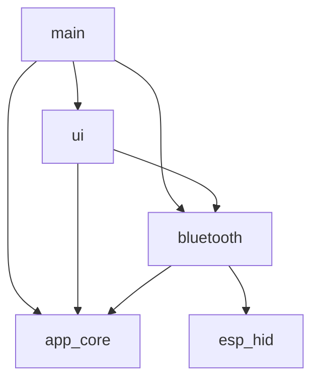

# Firmware architecture

For the complete implementation reference, screen-state registry and runtime
state machines, see the [developer guide](developer-guide.md). End-user page
controls are in the [user guide](user-guide.md).

The startup order, FreeRTOS tasks, queues, remote controls, Bluetooth lifecycle,
and persistent record format are retained through the source reorganization.

## Layout and ownership

```text
main/
  app_main.c                 Startup and task initialization
  app/                       Application UI task and its event queue
  drivers/                   Keypad scanner and OLED port
  ir/                        NEC capture/replay workers and RMT encoder
components/
  app_core/
    remote_model.c/.h        Remote types, names, identities, validation
    app_events.h            Application commands/events
    app_state.c/.h           Shared context, queues, profile edits and rollback
    app_storage.c/.h         NVS accounting, serialization, load and migration
    app_storage_internal.h  State-to-storage operations on the owned context
    profiles/                Keyboard mappings, text reports, mouse behavior
  bluetooth/
    bt_runtime.c/.h          Shared keyboard/mouse session worker
    bt_advertising.c/.h      Advertising data
    bt_ccc_store.c/.h        Bond-scoped notification subscriptions
  ui/
    include/                 Public navigation, event and screen interfaces
    ui_nav.c                 Navigation stack and event routing
    ui_screens.c             Shared lifecycle, dispatch and application events
    ui_common.c              Shared drawing and notices
    ui_internal.h            Private drawing helpers and feature callbacks
    ui_icons.c               Icon assets
    screens/                 Home, settings, remote, edit, wizard, Bluetooth, IR
  esp_hid/                   Existing ESP-IDF HID override
tests/host/                  Firmware checks with SDK/RTOS/NVS substitutes
```

Source/header pairs stay beside one another. UI public headers retain their
existing `include/` directory. Only startup, application task glue and board/IR
code belong to the `main` component. Old alternate entry points and unused
menu/HID implementations have been removed; Git history retains them.

## Dependency direction



This diagram shows project-component dependencies; SDK and managed-library
dependencies are declared separately in the component CMake files. Neither UI
nor Bluetooth depends on `main`. `app_core` has no dependency on either service.
The model and application event headers expose types without FreeRTOS, NVS or
Bluetooth-stack headers. Profile mapping/mouse logic uses the model header;
application state owns RTOS synchronization and queues.

## Runtime ownership

- The application UI task drains physical input and application-event queues,
  navigates screens and renders the OLED. Its initialization and timing remain
  in `main/app/app_ui_task.c`.
- Profile mutations remain owned by that UI task. `app_state.c` validates edits,
  protects shared data with the existing mutex, and restores RAM on a save
  failure. Storage receives the same context through its internal interface.
- The Bluetooth runtime retains one worker and the existing callback/message
  handoff. It owns the stack, session generations, connection lifecycle and HID
  reports. `bt_runtime_*` names reflect its shared keyboard/mouse responsibility.
  Keyboard-specific report-map names remain `bt_keyboard_report_map`.
- IR workers retain their command/event queues, request IDs and cancellation
  behavior. Keypad timing, GPIO assignments and OLED setup remain unchanged.

## Storage compatibility

The `remote_t` definition is unchanged: 104 bytes, with IR bindings beginning at
offset 20. The storage translation unit retains the compile-time layout check,
version-3 snapshot format, checksum, namespaces, text records, and version-1/2
and legacy-IR migration. The Bluetooth bond and subscription stores retain their
existing names and ownership.

## Making changes

Place screen-specific input/rendering code in its feature file under
`components/ui/screens/`. Shared drawing belongs in `ui_common.c`; shared
lifecycle and application-event handling belong in `ui_screens.c`. Keep internal
callbacks in the private UI header and expose user-facing component interfaces
through `include/`.

Place remote-profile data and mapping rules in `app_core`; place radio/session
operations in `bluetooth`. Add sources and dependencies explicitly to each
component's CMake file and update the host source lists when adding a translation
unit. Run `tests/host/run.ps1` and `idf.py build` before flashing. Changes to
hardware behavior also need the device checks in the Bluetooth and UI guides.
