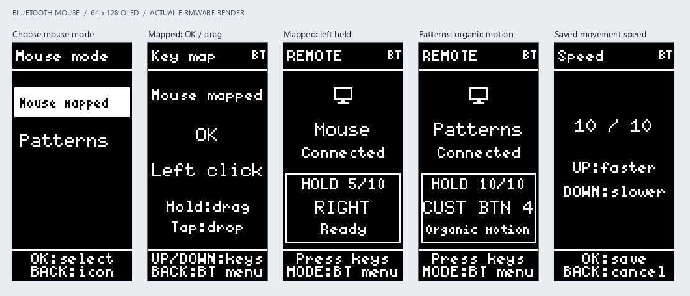

# Bluetooth mouse remotes

Choose **Add remote > BT > Mouse**, enter a name, pick an icon, then select
**Mouse mapped** or **Patterns**. Accepting the mode saves the remote and opens
its Bluetooth connection menu. Pair the computer with **UR <remote name>**.
Press **MODE** to control the mouse; press MODE again to return to the menu.
Both modes have fixed mappings, viewable under **Key map**.

The connection menu includes **Reconnect**, **Pair new**, **Unpair**, **Key map**,
**Speed**, and **Edit remote**. BACK from this menu, or HOME from its settings,
turns Bluetooth off. Pairing and saved accessory identities behave like
[keyboard remotes](bluetooth.md). Create a separate mouse profile to keep a
working keyboard pairing.

## Mouse mapped

| Remote key | Mouse action |
| --- | --- |
| UP / DOWN / LEFT / RIGHT | Move while held; release to stop |
| OK, short press | Left click; two short presses produce a double click |
| OK, hold for 700 ms | Latch left button down for dragging |
| OK, short press while dragging | Release left button to drop |
| PLAY/PAUSE | Right click |
| VOL CLICK | Middle click |
| VOL UP / VOL DOWN | Scroll up / down, repeating while held |
| CH UP / CH DOWN | Horizontal scroll right / left, repeating while held |
| CUST BTN 2 / CUST BTN 3 | Mouse button 4 / 5 (Back / Forward on supporting hosts) |
| CUST BTN 4 / CUST BTN 5 | Increase / decrease the saved movement speed |

To drag, hold OK until **HOLD** appears, release OK, and use the D-pad to move
the object. Tap OK to drop. Holding OK never sends an initial click. Right and
middle clicks and wheel reports preserve the latched left button. The remaining
keys are unassigned; MODE always belongs to the remote UI. Horizontal scrolling
and extra button actions depend on the host/application supporting them.

## Patterns

| Remote key | Action |
| --- | --- |
| RIGHT / LEFT / UP / DOWN | Continuous movement in that direction |
| CUST BTN 4 | Organic movement: curved strokes, changing directions/speeds and occasional rests |
| OK | Toggle left button held / released |
| VOL UP / VOL DOWN | Increase / decrease the saved movement speed |

Tap a pattern key to start it, and tap it again to stop. Pressing another pattern
key replaces the running pattern immediately. Hold a pattern key for at least
700 ms to run it until release; release stops that pattern, including when it
was already running before the hold. When holding the same running pattern key,
the initial press stops it and the long-press threshold starts it again.
Held-key repeats never repeatedly toggle a pattern.

OK controls left-button hold independently of movement. Turn it on before or
during a pattern to draw/drag, or leave it off to move the pointer freely. Other
keys are unassigned. Organic movement generates only pointer movement; it does
not click automatically.

## Saved speed and stopping

Each mouse remote has a **1–10** speed, initially **5**. In Mouse mapped,
**CUST BTN 4 / CUST BTN 5** increase / decrease it; in Patterns, **VOL UP/DOWN**
change it. Each press saves the new value immediately. The Bluetooth menu shows
the same current value as **Speed N/10**. In either mode, open **Speed** from the
Bluetooth menu, adjust with arrows or VOL UP/DOWN, then press OK to save. BACK
cancels. Save failures retain the previous value and allow retry. The saved speed
is used on the current connection and after reopening or rebooting the remote.
In mapped mode, VOL UP/DOWN remain wheel controls.

The OLED displays movement speed and **HOLD** when the left button is latched.
Returning to the menu stops movement and releases buttons while keeping Bluetooth
connected. Exit, Unpair, suspend, link loss and failed input delivery also clear
movement and button state. Reconnection starts idle; explicitly start movement
and button hold again.

## Verification

The host suite covers creation, fixed mappings, click/release ordering, double
clicks, drag preservation, both wheels, all patterns, hold/release, speed
persistence and failed saves, bounded variable organic motion, authentication,
subscription restoration, cancellation with a full queue, suspend, reconnect,
and failed sends. These are deterministic software checks.

Before relying on the firmware, flash it and verify on a real computer:

1. Pair each mouse mode, leave/reopen it, and reboot/reconnect without pairing again.
2. Check every mapped button, double click, vertical/horizontal scroll and drag/drop.
3. Check tap toggles, replacing patterns, long holds and release for all five patterns.
4. Toggle left hold during a pattern, then leave Remote mode and confirm release.
5. Change speed with VOL and with the menu; reopen/reboot and confirm the setting.
6. Check host sleep/wake, link loss, Unpair/Pair new, and switching between existing
   keyboard/IR profiles and both mouse modes.
