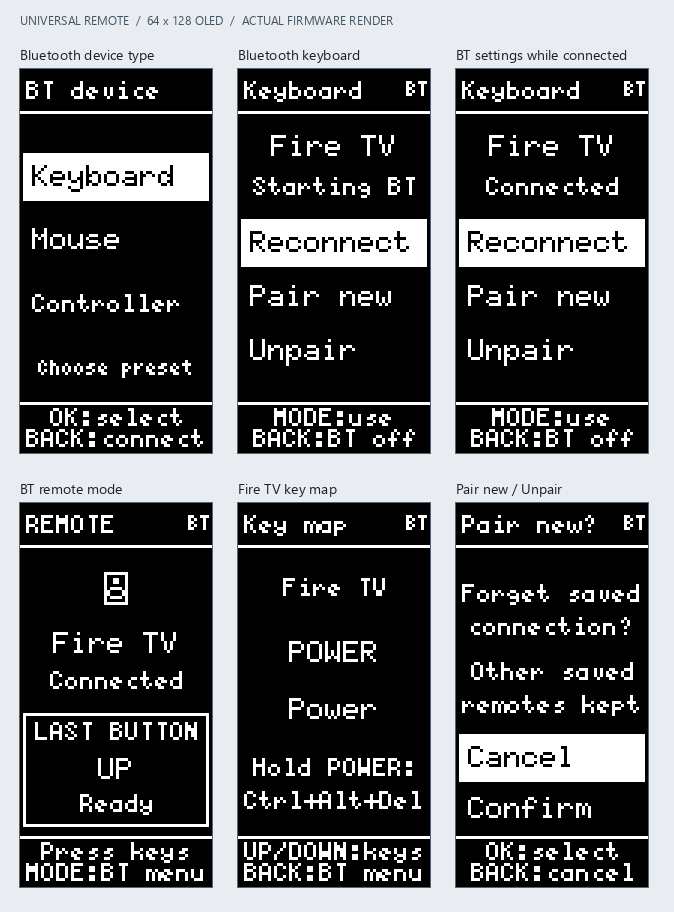
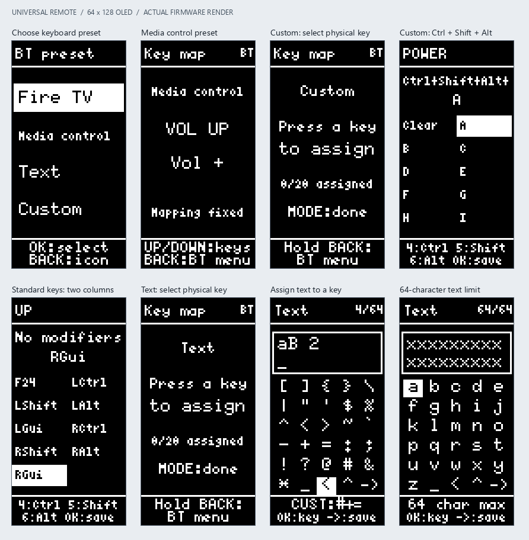

# Bluetooth remotes

For the full operating manual and exact per-page controls, see the
[user guide](user-guide.md). For task ownership and state-machine contracts,
see the [developer guide](developer-guide.md#bluetooth).

Keyboard and mouse remotes share the connection menu, pairing, reconnection,
Unpair and profile storage described here. See [mouse controls and patterns](bluetooth-mouse.md)
for mouse setup, fixed mappings and saved movement speed.

## Create and use

1. Choose **Add remote > BT > Keyboard** for the keyboard presets below, or
   **Mouse** for Mouse mapped / Patterns. Controller displays **On hold**.
2. Enter a name and select an icon, then choose **Fire TV**, **Media control**,
   **Text**, or **Custom**. Accepting the preset saves the remote and starts
   Bluetooth. Text and Custom open key assignment; MODE finishes assignment and
   opens the connection menu. BACK from the preset chooser returns to the icon;
   HOME discards the unfinished draft. No radio is enabled for an unfinished draft.
3. The OLED shows **Starting BT**, then **BT searching** for a new profile. Open
   Bluetooth accessory pairing on the Fire TV and select **UR <remote name>**.
4. **Connecting** means a link exists but encryption, profile storage, or keyboard
   notification setup is still pending. **Connected** means the selected HID reports can
   be sent. Verify the host's responses on the actual Fire TV.
5. Press **MODE** to enter Remote mode. All mapped keys now control the host;
   BACK and HOME are appliance commands. MODE returns to the same BT menu with
   Bluetooth still enabled. Settings navigation never sends appliance keys.
6. BACK from the BT menu returns to home and shuts down the HID service,
   disables the Bluetooth host and controller. HOME from BT settings also exits and shuts
   Bluetooth down. Pairing information remains saved.

From home, open the saved BT tile with OK before pressing MODE. MODE on that
home tile shows **OK:open first** and does not enable the radio. IR keeps its
direct MODE shortcut and also supports OK, then MODE, from its editor.

## Connection menu

Use UP/DOWN and OK. Five entries scroll through the three visible rows:

- **Reconnect:** reopen the saved host connection, or restart discovery after an
  error/timeout. An already connected session stays connected.
- **Pair new:** confirm forgetting this profile's previous host, then open a new
  two-minute pairing window with the same accessory identity. If pairing again
  to the same host, remove its saved accessory there first; the remote cannot
  delete the host's copy of its bond.
- **Unpair:** confirm forgetting this profile's peer and stop Bluetooth. Reconnect
  or Pair new can then begin fresh pairing. If the host retains a stale pairing,
  forget the accessory on the host as well before retrying.
- **Key map:** inspect the Fire TV or Media control preset, or edit Text/Custom
  assignments by pressing the physical key to map. MODE finishes assignment;
  holding BACK returns to the menu. HOME/BACK can themselves be assigned.
- **Edit remote:** change its name/icon or remove it. Removing a BT remote also
  clears its pairing before deleting the profile. Cancel is selected by default.
  A changed advertised name takes effect the next time the remote is opened.

Opening a previously paired profile advertises only for that profile's saved
peer using the controller whitelist. Disconnection restarts reconnection while
the remote stays open. Fresh pairing has a two-minute timeout; initialization,
authentication, storage, and connection-setup failures are reported instead of
enabling key sending on an unauthenticated link. Reconnect retries the session.
The peripheral advertises for a host to connect; it does not scan a list of TVs.
On BT error, the menu shows the failed startup step and the numeric error code;
the serial log records the same step and the ESP-IDF error name.

Each profile is a separate BLE accessory with its own preferred host, constant
static-random address and isolated SMP key store. Its address stays fixed across
exit, reconnect, reboot, rename, Unpair and Pair new. Only creating a different
profile creates a different identity. Existing public-address profiles keep that
public identity too. Unpair removes a bond, not the accessory identity.

The SDK's public `esp_bt_config_file_path_update()` API selects a separate NVS
namespace before Bluedroid initialization. The namespace is derived from the
full local address, not the profile name or index. It contains that profile's
local IRK/ER and peer security keys, so two profiles paired to the same computer
do not overwrite one another's keys. Profile reordering does not move bonds.

Existing working profiles retain the old shared namespace until explicit
Unpair/Pair new. During that transition a legacy host bond is retained if another
legacy profile still references it. The cleared profile is then durably moved
to its own namespace without changing its MAC. This can require removing the
old pairing on the host once, since the isolated namespace starts with new keys.
Unrelated remotes, IR recordings, key mappings and text are preserved.
Failed fresh-pairing attempts keep the window open and show Forget on host;
no input reports are allowed until authentication and profile storage succeed.

The HID component retains the host's actual notification subscriptions for each
profile and canonical bonded peer. They are saved only after authentication and
durable profile storage, restored before advertising, and cleared on Unpair or
Pair new. Disabled subscriptions stay disabled. This includes keyboard boot,
report-mode and consumer descriptors and the battery descriptor; raw GATT
handles are never stored. A small project-local `esp_hid` source replacement
adds explicit snapshot APIs and zero-initializes the SDK's report state; see
`components/esp_hid/README.md` and [Espressif issue 13054](https://github.com/espressif/esp-idf/issues/13054).
The keyboard GATT database layout remains unchanged; a new mouse profile has a
separate mouse report map. Both Bluedroid and the controller
are deinitialized on exit so another profile starts with fresh link-layer state.
Older firmware did not retain these subscriptions. If an existing Windows bond
keeps flickering or stalls at Connecting after this upgrade, use Pair new and
remove/re-add that accessory in Windows once. The firmware cannot reconstruct
a subscription the old version never saved; it must not assume notifications
were enabled. Subsequent reconnects restore the freshly recorded settings.

## Keyboard presets

**Fire TV** preserves the mappings below, including its special Power hold.
**Media control** maps PLAY/PAUSE to media play/pause, VOL UP/DOWN to volume,
VOL CLICK to mute, CH UP/DOWN to next/previous track, CH CLICK to stop, CUST BTN
2/3 to rewind/fast-forward, and POWER to Consumer Power. It also includes the
arrow keys, Enter on OK, Esc on BACK, and launcher Home on HOME. The remaining
three custom buttons are unassigned. Each command includes a release report.

**Custom** starts with empty bindings. Press a physical key, then choose from
the two-column list of letters, digits, punctuation, navigation keys, F1–F24,
keypad keys and standard left/right modifiers. Arrows move through the list;
OK saves and BACK cancels. While choosing, **CUST BTN 4 toggles Ctrl**,
**CUST BTN 5 toggles Shift**, and **CUST BTN 6 toggles Alt**. They can be combined
and toggled off; the active choices are shown above the list. Select Clear to
unassign a key. Modifier choices are saved per binding, loaded when editing that
binding again, and reset for an unassigned key. The modifier shortcuts apply
only inside this editor; CUST BTN 4/5/6 remain assignable physical keys.

**Text** starts empty. Press a physical key to enter its string with the screen
keyboard. Custom buttons and ^ cycle abc/ABC/123/symbols; the underscore cell
inserts a space, < deletes and -> saves. BACK cancels. Saving empty text clears
the assignment. Up to **64 characters per key** are supported; spaces are kept.
Text uses standard US-layout keyboard reports for ASCII letters, digits and
punctuation, so the connected host should use a US keyboard layout. A press in
Remote mode types the string character by character, including a release after
each character (40 ms press, 10 ms gap). Repeated arrow/channel events do not
retype whole strings. MODE or leaving the remote cancels remaining characters;
an attempted press is released even when sending fails or playback is cancelled.

Text/Custom changes are saved before confirming success. Save failures retain
the existing binding/text and keep the editor open for retry. Updated mappings
are used on the current Bluetooth connection without re-pairing. Only Fire TV
uses the special short/held Power behavior; other presets use POWER like an
ordinary assignable key. MODE always controls the local UI.

## Fire TV mapping

| Physical remote button | HID signal |
| --- | --- |
| BACK | Esc (the selected alternative to F2) |
| HOME | Consumer AC Home, the house/launcher key |
| CUST BTN 4 | Keyboard Application/Menu, the reference keyboard's Fn+Ctrl function |
| CH UP | F7 |
| PLAY_PAUSE | F8 |
| CH DOWN | F9 |
| UP / DOWN / LEFT / RIGHT | Corresponding arrow key |
| OK | Enter |
| POWER, short press | Keyboard PC Power, sent on release |
| POWER, hold for 700 ms | Ctrl+Alt+Delete, sent once; no short Power signal |

Fn is a reference keyboard's local layer selection, not an extra modifier to
transmit. Home uses Consumer usage `0x0223`, Menu uses Keyboard `0x65`, and PC
Power uses Keyboard `0x66`, following the [Android HID mapping table](https://source.android.com/docs/core/interaction/input/keyboard-devices).
Keyboard Home (`0x4A`) would move a text cursor rather than open the launcher.
F7/F8/F9 remain exactly the requested function keys.

The remaining eight appliance buttons are unassigned. MODE always belongs to
the local UI. Every transmitted press is followed by a matching zero/release
report. Arrow/channel repeats come from the existing keypad repeat behavior;
modifier and Power holds are not left asserted. Switching MODE cancels a
pending short Power press and releases reports.
An explicit mapped button press is also allowed while the host has suspended
HID, using ESP-IDF's advertised remote-wake capability. Host wake behavior must
be checked on the Fire TV.

## Implementation and verification

`components/bluetooth/bt_runtime.c` owns Bluetooth on one worker task. The UI requests sessions,
reads status snapshots, and commits peer identities to the existing profile
store. Callback generations/session IDs reject stale events. Connected status
requires successful encryption, durable peer storage, and a subscribed keyboard
input report. The HID descriptor has an eight-byte keyboard report (ID 1) and
a two-byte Consumer Control report (ID 2). There is no automatic volume demo.
Mouse profiles use a separate five-byte report (ID 1): five buttons, relative
X/Y, vertical wheel and horizontal AC Pan. The same worker schedules movement
at a nominal 20 ms interval and stops it on exit, suspend, disconnect or send
failure. No pattern resumes automatically after reconnecting.
The controller is initialized once and enabled only during an open BT
session. Bluedroid is disabled and deinitialized on exit, then initialized again
on the next visit; keeping only a disabled host led to a privacy-list crash in
ESP-IDF 5.5.2. Exit disables the controller/radio without using the final-deinit
API as a routine mode switch. Each session clears the controller whitelist
before allowing the selected saved peer, or all peers during fresh pairing.
Startup explicitly disables retained controller address-resolution state before
configuring the whitelist. A saved IRK peer then uses Device Privacy mode and
address resolution, accepting either its identity or resolvable private address.
Fresh pairing and fixed-address peers leave resolution disabled. Each completion
must arrive before advertising starts; a ten-second startup timeout or privacy
failure reports BT error instead of opening the saved-host whitelist.

The GATT callback records the actual link before queuing its worker message.
Exiting, switching or choosing Pair new can invalidate an unprocessed CONNECT
message; shutdown still disconnects that link and waits for the HID disconnect
callback to finish before destroying services. If disconnection does not complete
within 1.5 seconds, shutdown reports an error and leaves services intact for a
retry. This avoids entering SDK teardown underneath a live connection. Startup
and shutdown stages are logged and shown on the Bluetooth menu to distinguish a
queued open from a stall inside the previous shutdown.

The COM7 regression capture on 2026-10-28 reproduced a shutdown that never
completed; opening other remotes then left their menus at Starting BT because
the shared worker was still in the earlier shutdown. A new host regression
test reproduces the missed queued CONNECT and fails before the link-tracking
fix. After flashing the fix, COM7 recorded saved-mouse reconnection, fresh
pairing, Pair new, and repeated switching between mouse and keyboard profiles
with completed shutdowns. The user repeated the original sequence and confirmed
it worked. Rapid switching also produced some host connection failures (0x08 /
0x3E) while Reconnecting; these did not block subsequent shutdown/open requests.

Unpair uses a separate stack-only path: it opens the selected bond store,
removes the selected peer, waits for removal completion, and requests durable
profile storage. There is no HID initialization or advertising during this
transaction. After the save acknowledgment, it stops or restarts in pairing mode
with the same local address. A missing saved bond reports an error and requires
explicit Pair new rather than silently pairing to a different appliance.

Security uses headless Just Works bonding with Secure Connections negotiation
and encryption/identity key distribution. No artificial display, passkey or
confirmation requirement is imposed. Host capabilities determine whether Secure
Connections or legacy pairing is negotiated.

The host runner separately compiles the production worker with deterministic
ESP-IDF/RTOS substitutes. Checks cover privacy ordering/failures, stable identities,
namespace isolation for the same host, profile rename/reordering, shared legacy
bonds, pairing/forget transactions, authenticated-peer selection and old profile
storage migration. Additional checks cover bonded notification persistence,
restoring before advertising, waiting for authentication, explicit host disable,
unpair cleanup, independent local/peer identities and storage errors.
They do not emulate radio traffic. Serial diagnostics report
local identity, selected namespace and connection state without printing keys.

BT metadata and Custom bindings overlay the unused IR-code area of BT profiles.
`remote_t` remains 104 bytes with the same offsets. Existing version-1 profiles
load as Fire TV. Version-1 and version-2 records load with the legacy bond-store
marker, ignoring the previously unused byte. New saves use a version-3 snapshot
with the same profile records and appended assigned text strings. A checksum covers the entire
snapshot, including strings. Text, mappings and peer metadata share a single NVS
save, with RAM rollback on failure. IR and legacy recording migration are retained.

The COM7 hardware check on 2026-10-26 confirmed advertising, encrypted pairing,
automatic reconnection after leaving/reopening the saved remote, and controller
shutdown on exit. The startup `ESP_ERR_INVALID_ARG` was caused by passing a
two-byte service UUID to Bluedroid's structured advertising API; that API needs
the 128-bit Bluetooth-base representation even for the 16-bit HID service.
The host suite now checks this API contract. Unpairing locally still requires
forgetting the old accessory on the host before a fresh host-side pairing.
After the identity/lifecycle corrections, Windows recorded removal of the old
pairing at 20:18:56 IST and a successful new pairing at 20:19:11 IST on the same
date; COM7 also reached Connected. Earlier failed attempts recovered after
toggling PC Bluetooth. This is evidence of successful recovery, not proof that
every Windows adapter/cache state is handled. Microsoft's [connection troubleshooting](https://support.microsoft.com/en-us/windows/hardware/bluetooth/troubleshoot-bluetooth-not-connecting-in-windows)
includes removing/re-adding the accessory and toggling Bluetooth.

For a Fire TV test, create a separate BT Keyboard profile (for example Fire TV)
and keep PC Bluetooth off during initial pairing. A still-paired PC profile
accepts only its saved PC peer; it must use Pair new before accepting a TV.

Run the host suite and ESP-IDF build before flashing. On hardware, check:

1. Fresh pair, first key delivery, all twelve mapped short actions, and Power hold.
2. Reboot the remote, reopen its BT tile, and reconnect without pairing again.
3. Cycle MODE repeatedly; confirm the host remains connected and settings keys
   only navigate the OLED.
4. BACK/HOME out of the BT menu/settings; confirm the host disconnects and the
   controller powers down. Reopen and reconnect.
5. Lose the host link while open; check reconnect status and recovery.
6. Cancel/confirm Unpair and Pair new; reconnect with the same and a different host.
7. Let fresh pairing expire and retry. Check a stale host pairing after unpairing.
8. Save two host profiles, alternate them, remove one, and verify the other and all
   IR recordings remain usable.
9. Create each keyboard preset; verify Media volume/mute/playback, a Custom
   Ctrl/Shift/Alt combination, repeated characters and punctuation in Text,
   cancellation with MODE, and retention of assignments after reboot.

## Android reconnect regression check

First keep any working existing pairing and verify exit/reopen still works.
Open the paired profile, leave it for an IR or another BT remote, and return.
Expect `Peer address resolution enabled`, then `Reconnecting`, `Connecting`,
and `Connected`. Confirm a mapped key reaches the phone/tablet. Repeat after
Android rotates its private address (wait at least 15 minutes, or toggle host
Bluetooth), after remote reboot, and with Reconnect from the menu. Also repeat
with Windows and alternate two saved hosts; neither may take over the other's
profile. A trace stuck at Reconnecting without a GATT-link log still requires
checking host initiation and the over-the-air/HCI address-resolution behavior.
If startup reports Peer privacy or Address resolution error, capture that error
and the serial log before trying Pair new; do not erase bonds to hide the failure.

## Stable identity and Windows re-pair check

1. Record the profile identity printed on COM7 and pair it in Windows.
2. Exit/reopen it and confirm automatic encrypted reconnection.
3. Choose Unpair on the remote. Remove that same accessory in Windows too.
4. Choose Pair new and pair again. Confirm the COM7 identity is unchanged and
   Windows recognizes the same address, rather than another same-name accessory.
5. Reboot the remote and reconnect again; check one mapped key on the host.
6. Pair another profile to the same Windows computer and alternate the profiles.
   Each must use a distinct constant address and namespace. Unpairing one must
   leave the other's encrypted reconnection working.

Old duplicate entries created by earlier firmware are host-side records; stop
using those old addresses and remove the stale entries on the host. Renaming a
profile can also leave a cached display name until the host refreshes it; it does
not change the BLE identity.

COM7 validation on 2026-10-27 (ELF SHA prefix `318b53863`): the old UR agms
pairing still reproduced the failure after the upgrade. A fresh Windows pairing
of UR pqr reached Connected. Reopening restored all three HID descriptor
subscriptions and reached encrypted Connected; the user confirmed three profile
switch/return cycles without toggling Windows Bluetooth. Pair new and pairing
again retained UR pqr's `EE:18:FE:D4:82:F0` identity. Another freshly paired
profile also reconnected in the captured switch sequence. These results do not
establish compatibility with every Windows adapter/cache state. A subsequent
hardware restart retained the same profile address and bond, restored all three
HID descriptor subscriptions, and reached Connected again without pairing.
The user then confirmed Enter/arrow key delivery in Windows Notepad. Validation
also passed 910 UI/storage checks, 272 worker checks and 31 CCC storage checks;
the normal ESP-IDF/GCC build and hash-verified COM7 flash succeeded.
