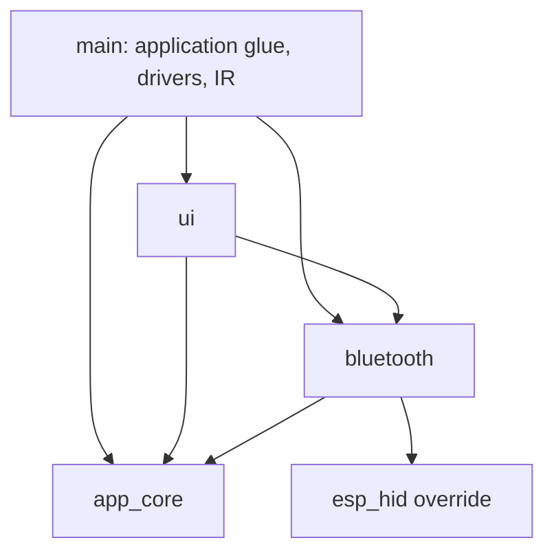
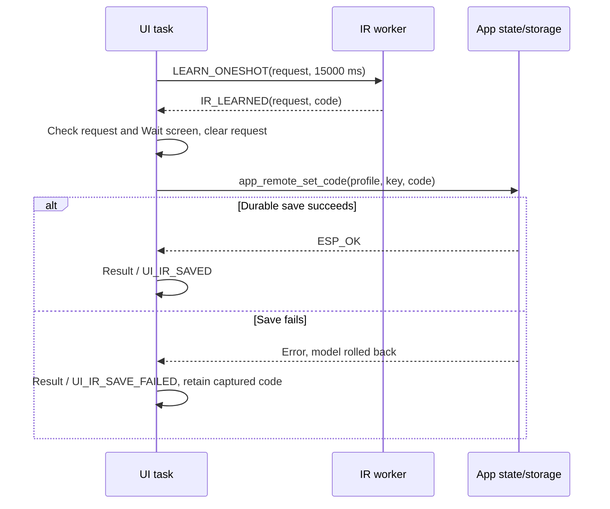
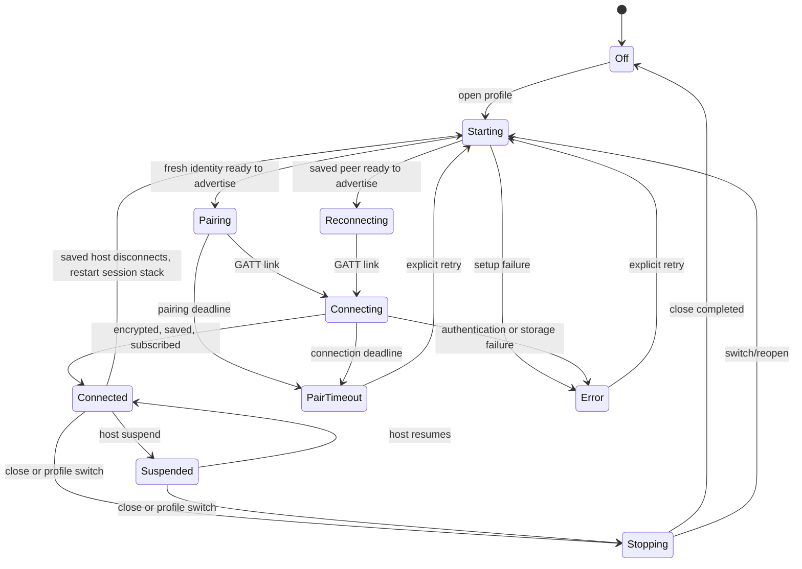
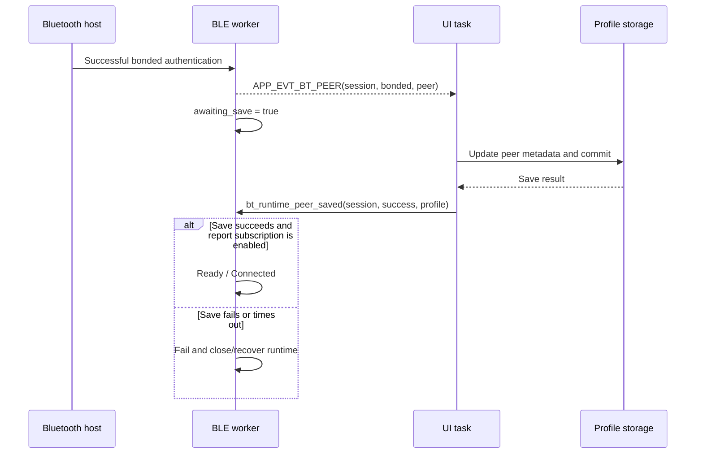

# Universal Remote: developer guide

This is the implementation reference for the current ESP32-S3 firmware. For
operating instructions and page-specific button behavior, see the
[user guide](user-guide.md). The shorter [architecture overview](architecture.md)
shows the directory layout; the [reorganization record](reorganization-verification.md)
documents the baseline compatibility checks.

Behavior and source reference checked on **2026-10-28**.

## Contents

- [Platform and source ownership](#platform)
- [Startup, tasks and queues](#runtime)
- [Input and navigation state machine](#navigation)
- [Complete screen registry](#screen-registry)
- [IR workflow and request lifecycle](#ir)
- [Bluetooth lifecycle and cancellation](#bluetooth)
- [Keyboard and mouse output states](#output)
- [Model, persistence and migration](#storage)
- [Build, tests and diagnostics](#verification)
- [Extension rules](#extensions)

<a id="platform"></a>
## Platform and source ownership

The project targets **ESP32-S3 with ESP-IDF 5.5.2**, FreeRTOS, Bluedroid BLE,
RMT NEC capture/replay and u8g2. The OLED is SH1106, physically 128x64 and rotated
clockwise to a logical **64x128** canvas. Bluetooth Controller and Wi-Fi remain
UI placeholders; there is no gamepad backend or IP-command transport.

| Location / interface | Ownership |
| --- | --- |
| [main/app_main.c](../main/app_main.c) | Startup composition and initialization order. |
| [main/app/app_ui_task.c](../main/app/app_ui_task.c) | Display setup, UI queue, application-event draining and periodic UI ticks. |
| [main/drivers/keypad.c](../main/drivers/keypad.c) | Eight-node scanner, debounce, physical key IDs and press variants. |
| [main/drivers/oled.c](../main/drivers/oled.c), [oled_port.h](../main/drivers/oled_port.h) | I2C/u8g2 port and portrait constructor. |
| [main/ir/ir_nec.c](../main/ir/ir_nec.c), [encoder](../main/ir/ir_nec_encoder.c) | IR command worker, receive callbacks, decoder and encoder. |
| [remote_model.h](../components/app_core/remote_model.h), [remote_model.c](../components/app_core/remote_model.c) | Domain types, names, identities, assignment counts and validation. |
| [app_events.h](../components/app_core/app_events.h) | IR commands and application result/peer events. |
| [app_state.c](../components/app_core/app_state.c), [app_state.h](../components/app_core/app_state.h) | Global context, queues, mutex, profile mutations and rollback. |
| [app_storage.c](../components/app_core/app_storage.c) | NVS snapshot format, migrations and on-demand storage accounting. |
| [profiles/](../components/app_core/profiles/) | Key mappings, text translation, mouse state and injectable output callbacks. |
| [bt_runtime.c](../components/bluetooth/bt_runtime.c), [bt_runtime.h](../components/bluetooth/bt_runtime.h) | Single keyboard/mouse BLE session worker and public status snapshot. |
| [bt_advertising.c](../components/bluetooth/bt_advertising.c), [bt_ccc_store.c](../components/bluetooth/bt_ccc_store.c) | Advertising payload and persistent notification subscriptions. |
| [ui_nav.c](../components/ui/ui_nav.c), [ui_screens.c](../components/ui/ui_screens.c) | Stack navigation, shared lifecycle, screen dispatch and application-event handling. |
| [ui_common.c](../components/ui/ui_common.c), [ui_internal.h](../components/ui/ui_internal.h), [screens/](../components/ui/screens/) | Private drawing/helpers and feature-specific page handlers/renderers. |
| [components/esp_hid/](../components/esp_hid/) | Project-local SDK HID override for bonded CCC snapshot/restore. |

Project-component dependency direction is deliberately acyclic:



`app_core` owns Bluetooth **profile rules**, not the Bluetooth stack. It has no
dependency on `ui`, `bluetooth` or `main`. Model/event headers are independent
of FreeRTOS, NVS and BLE stack types. Application state adds the RTOS context;
storage's internal interface receives that owned context. CMake public/private
requirements declare SDK dependencies in addition to the project graph above.

### Board resources

| Resource | Configuration |
| --- | --- |
| Keypad nodes 1–8 | GPIO 4, 7, 15, 16, 17, 10, 11, 6, in that order. |
| OLED | I2C SDA 8, SCL 9, 400 kHz, address 0x3C, reset GPIO disabled (-1). |
| IR transmitter / receiver | GPIO 18 / GPIO 2. |
| IR timing / carrier | 1 MHz RMT resolution; 38 kHz TX carrier with 0.33 duty cycle. |

The keypad reports one contact pair at a time and ignores node pair 7/8.
See [keypad wiring](keypad.md) for the complete contact-to-button mapping.

<a id="runtime"></a>
## Startup, tasks and queues

`app_main()` calls, in order:

1. `app_state_init()`: clear the context, allocate command/event queues and the
   model mutex, initialize NVS and load/migrate profiles. A storage error is
   recorded instead of erasing recordings.
2. `bt_runtime_init()`: create its queue/event group and idle worker. The radio
   remains off until a profile is opened.
3. `ir_start_tasks()`: initialize RMT and start the IR worker.
4. `app_ui_start()`: create the physical-input queue and UI task.
5. `start_keypad_task(ui_get_queue())`: start forwarding physical input to UI.

| Execution context | Task name | Stack argument (bytes) | Priority | Owns / waits for |
| --- | --- | ---: | ---: | --- |
| UI | `ui_task` | 8192 | 5 | Display/context, input queue, app events, navigation and rendering. |
| IR | `ir_worker` | 4096 | 6 | RMT capture/transmit and IR commands. |
| Bluetooth | `bt_keyboard` | 6144 | 5 | Stack/controller/HID lifecycle and keyboard/mouse output. The retained task/log name predates the runtime rename. |
| Keypad | `keypad_task` | 4096 | 5 | Contact scan, debounce, repeat/hold generation. |

BLE SDK callbacks and the RMT receive callback are separate execution contexts;
they hand information to workers rather than mutating the UI. The display and
`ui_ctx_t` are static UI-task objects, not large task-stack locals.

| Channel | Capacity | Producer → consumer | Contract |
| --- | ---: | --- | --- |
| UI queue | 32 `ui_event_t` | Keypad → UI | Send without waiting; log/drop when full. |
| `app_ctx_t.cmd_q` | 16 `app_cmd_t` | UI → IR worker | IR-only learn/cancel/transmit commands. |
| `app_ctx_t.evt_q` | 16 `app_evt_t` | IR/Bluetooth workers → UI | `app_post_evt` waits up to 50 ms, then logs if full. |
| Bluetooth queue | 32 `message_t` | UI and BLE callbacks → BLE worker | Session/generation-tagged requests and completions. |
| RMT completion queue | 4 receive messages | RMT callback → IR worker | Signals captured-symbol availability. |

Each UI loop waits up to 25 ms for one physical event, drains all queued app
events, dispatches a system `UI_EV_TICK`, and renders if dirty. This is a
wait bound, not a fixed frame rate. The first frame is written before the
OLED is awakened. The splash then runs for about two seconds.

Profile edits are owned by the UI task. The model mutex protects shared copies
and readers. Do not interpret the mutex as support for arbitrary concurrent
writers: multi-step edit/save/rollback relies on the single-writer contract.

<a id="navigation"></a>
## Input and navigation state machine

### Physical events

The stable key ID is the PCB number, **1–21**. Key 2 is MODE and is excluded
from `remote_key_assignable()`. The remaining 20 keys can be IR bindings or
Text/Custom targets.

The scanner takes five matching samples. Each inter-sample wait is at least
one RTOS tick even when the configured 7 ms rounds down at the project's tick
rate. It polls between scans, emits the old key's release before a new press,
and timestamps events using `esp_timer_get_time()/1000`.

| Input | Generated event |
| --- | --- |
| Arrows / OK / BACK / MODE / HOME | Corresponding `UI_EV_*` navigation event, retaining the physical ID in `value`. |
| Other assignable keys | `UI_EV_KEY` with physical ID. |
| Release | `UI_EV_KEY_RELEASE`. |
| OK/BACK/HOME/POWER held ≥700 ms | `UI_EV_OK_LONG`, `UI_EV_BACK_LONG`, `UI_EV_HOME_LONG`, `UI_EV_POWER_LONG`. |
| Arrow or C4 held ≥700 ms | `UI_EV_KEY_LONG`. |
| Arrows, VOL UP/DOWN, CH UP/DOWN | Repeat the original event after 350 ms, then at 120 ms intervals, subject to scan time; `repeat=true`. |

A long event follows the initial press; it does not replace it. Release,
POWER-long and generic-key-long events are discarded by navigation outside
Remote mode. `UI_EV_OK_LONG`/BACK-long/HOME-long still reach the special
navigation rules where appropriate. Source enum entries for IR/BLE/encoder
exist, but the current physical-input producer is the keypad; app worker
completions use the separate `app_evt_t` queue.

### Stack operations

`UI_STACK_MAX` is **8**. Each entry holds a `ui_screen_id_t`; screen descriptors
contain enter, exit, handle and render callbacks. All descriptors currently use
the common lifecycle/dispatch functions in `ui_screens.c`.

| Operation | Lifecycle and state |
| --- | --- |
| `ui_nav_push` | Append a screen, call its enter callback, mark dirty. **Does not exit the covered parent.** |
| `ui_nav_pop` | Exit current screen and reveal parent; clear notice and mark dirty. Root cannot be popped. |
| `ui_nav_replace` | Exit current screen and enter replacement at the same depth. |
| `ui_nav_home` | Exit every stacked screen, clear creation draft/editing state, clamp home selection and push Home. |
| `ui_nav_render_if_dirty` | Clear buffer, render active screen, send buffer, clear dirty flag. |

Push/replace reject invalid IDs and push rejects a full stack; they return
`false`. Callers adding new paths should handle that result. Rendering and input
handlers receive only the current screen, not the covered parent.

### Navigation interception order

1. Filter Remote-only press variants.
2. Determine whether this is an IR picker/detail or an editable Text/Custom picker.
3. On BACK press in a learning/assignment path, remember `back_target_top`.
   IR details swallow the short BACK. Pickers let it select BACK as a binding.
4. A BACK hold unwinds to that remembered depth, including an editor opened by
   the initial BACK press. This prevents returning to the wrong intermediate page.
5. Outside Splash/Remote, HOME goes home except on an assignable picker;
   HOME-long goes home even from that picker.
6. Dispatch to the active handler; mark dirty for non-NONE/non-TICK events.

These rules explain why a physical BACK/HOME cannot simply be converted to a
global escape key. MODE has no global navigation handler: only the relevant
home/editor/Bluetooth/Remote/assignment handlers act on it.

### Lifecycle side effects

- Enter Splash records its start timestamp.
- Enter Storage sets `storage_pending`; the tick handler scans NVS only after
  its initial Reading frame has rendered (`!ctx->dirty`). Refresh sets it pending again.
- Exit Remote invalidates/releases Bluetooth input, stopping text/mouse output.
- Exit IR Wait cancels the current receive request if one remains active.
- Exit BT Device closes the session, clears UI session/pending flags and TX ID.

Because pushing a child does not exit its parent, the BT Device screen keeps
the radio session alive under Remote mode, assignment, confirmation and editing
pages. Returning home unwinds it and closes Bluetooth.

<a id="screen-registry"></a>
## Complete screen registry

The enum order below matches `ui_screen.h`. Page links lead to the complete
user-facing controls; this table records implementation ownership and state.

| Screen ID | User page | Feature file / state and transitions |
| --- | --- | --- |
| `UI_SCREEN_SPLASH` | [P00](user-guide.md#p00) | Common dispatch; timestamp → replace with Home after 2 s. |
| `UI_SCREEN_HOME` | [P01](user-guide.md#p01) | `ui_home.c`; `home_sel` → creation, editor, BT session or direct IR control. |
| `UI_SCREEN_REMOTE` | [P02](user-guide.md#p02) | `ui_remote.c`; active profile, TX request/status, pending Fire TV Power; MODE pops. |
| `UI_SCREEN_EDIT` | [P03](user-guide.md#p03) | `ui_edit.c`; `menu_sel`, `editing`, `draft` → setup/name/icon/remove. |
| `UI_SCREEN_ADD_TYPE` | [P04](user-guide.md#p04) | `ui_wizard.c`; transport draft → BT type or Name. |
| `UI_SCREEN_NAME` | [P05](user-guide.md#p05) | `ui_wizard.c`; draft name/keyboard page/selection → Icon or confirmed rename. |
| `UI_SCREEN_ICON` | [P06](user-guide.md#p06) | `ui_wizard.c`; icon selection → save IR/Wi-Fi, BT preset, or confirmed icon edit. |
| `UI_SCREEN_IR_KEYS` | [P07](user-guide.md#p07) | `ui_ir.c`; choose physical key → saved-command inspection or capture. |
| `UI_SCREEN_IR_REPLACE` | [P08](user-guide.md#p08) | `ui_ir.c`; inspect stored code; OK replaces page with Wait. |
| `UI_SCREEN_IR_WAIT` | [P09](user-guide.md#p09) | `ui_ir.c`; request/status/deadline results; retry, cancel, or replace with Result. |
| `UI_SCREEN_IR_RESULT` | [P10](user-guide.md#p10) | `ui_ir.c`; captured code and saved/save-failed state; retry save or pop. |
| `UI_SCREEN_REMOVE` | [P11](user-guide.md#p11) | `ui_edit.c`; Cancel/Remove, asynchronous BT unpair-before-delete flag. |
| `UI_SCREEN_CONSTRUCTION` | [P12](user-guide.md#p12) | `ui_edit.c` + common handler; saved Wi-Fi placeholder, Exit → Home. |
| `UI_SCREEN_BT_TYPE` | [P13](user-guide.md#p13) | `ui_wizard.c`; keyboard/mouse draft, generated local identity; controller blocked. |
| `UI_SCREEN_BT_DEVICE` | [P14](user-guide.md#p14) | `ui_bluetooth.c`; menu selection, session/status snapshot; owns session lifetime. |
| `UI_SCREEN_BT_CONFIRM` | [P15](user-guide.md#p15) | `ui_bluetooth.c`; Pair new vs Unpair action, default Cancel. |
| `UI_SCREEN_BT_KEYS` | [P16](user-guide.md#p16) | `ui_bluetooth.c`; fixed-map viewer or physical-key assignment picker. |
| `UI_SCREEN_BT_PRESET` | [P17](user-guide.md#p17) | `ui_wizard.c`; keyboard preset/mouse mode → final profile creation. |
| `UI_SCREEN_BT_BINDING` | [P18](user-guide.md#p18) | `ui_bluetooth.c`; selected usage and modifier bits → durable Custom binding. |
| `UI_SCREEN_BT_TEXT` | [P19](user-guide.md#p19) | `ui_wizard.c`; text draft, shared keyboard renderer → durable text. |
| `UI_SCREEN_BT_SPEED` | [P20](user-guide.md#p20) | `ui_bluetooth.c`; speed draft 1–10 → durable per-profile speed. |
| `UI_SCREEN_SETTINGS` | [P21](user-guide.md#p21) | `ui_settings.c`; About/Storage selector. |
| `UI_SCREEN_ABOUT` | [P22](user-guide.md#p22) | `ui_settings.c`; embedded ESP-IDF app version; no edits. |
| `UI_SCREEN_STORAGE` | [P23](user-guide.md#p23) | `ui_settings.c`; pending/cached/error storage snapshot, on-demand refresh. |

The same screen ID can have different contextual behavior: Name create vs
rename; Icon create vs edit; BT Keys fixed vs editable; BT Preset keyboard vs
mouse; Remote IR vs keyboard vs mouse. Do not introduce a separate screen ID
unless it represents a distinct navigation/lifecycle state.

<a id="ir"></a>
## IR workflow and request lifecycle

Commands use `app_send_cmd()` and are currently IR-only:

| Command | Payload / worker action |
| --- | --- |
| `APP_CMD_IR_LEARN_ONESHOT` | Request ID and timeout; reset/rearm RX, then listen. UI requests 15 s. |
| `APP_CMD_IR_LEARN_CANCEL` | Cancel only a matching active learn request. |
| `APP_CMD_IR_TX_SEND` | Request ID and 16-bit address/command pair; transmit, wait up to 500 ms and report completion. |

The worker is idle on an indefinite queue wait when not learning. During
capture it polls commands with a 20 ms wait so cancellation remains responsive.
RMT completion is consumed separately; unsupported/noisy captures rearm within
the original deadline. A new learn request resets any previous receiver state.

| Event | UI consequence |
| --- | --- |
| `APP_EVT_IR_LEARNED` | Match current request and Wait page; retain code, clear request, save binding, replace with Result. |
| `APP_EVT_IR_UNSUPPORTED` | Set unsupported status; keep listening under the same request/deadline. |
| `APP_EVT_IR_LEARN_TIMEOUT` | Clear request and display retryable timeout on Wait. |
| `APP_EVT_IR_LEARN_FAILED` | Clear request and display retryable read failure on Wait. |
| `APP_EVT_IR_TX_DONE` | For matching nonzero TX ID, display Sent. |
| `APP_EVT_IR_TX_FAIL` | For matching nonzero TX ID, display Send failed. |

The UI's `ctx->ir.status` has these states:

| UI state | Meaning |
| --- | --- |
| `UI_IR_IDLE` | Initial context state before learning. |
| `UI_IR_WAITING` | A new capture is pending. |
| `UI_IR_UNSUPPORTED` | A non-decodable frame was received; request remains active. |
| `UI_IR_TIMEOUT` | Capture window expired; OK starts a new request. |
| `UI_IR_FAILED` | Command submission or receive setup failed; OK retries. |
| `UI_IR_SAVED` | Captured command was durably stored. |
| `UI_IR_SAVE_FAILED` | Captured code is retained in UI RAM for Retry save; previous binding remains stored. |



`ctx->sequence` supplies request IDs. Clearing an ID on cancel/exit prevents
late results being attached to a different key/profile. Retrying capture gets
a new ID; retrying storage reuses the captured code without receiving again.
Clear the completed request **before** replacing Wait with Result so its exit
callback does not cancel an already completed operation.

NEC capture is the existing raw **16-bit address + 16-bit command**, LSB-first
representation. It does not validate standard NEC inverse-byte semantics or
decode the short held-key repeat frame. It is not a general IR protocol layer.
Physical held-key repeat sends repeated full commands via the normal UI path.

<a id="bluetooth"></a>
## Bluetooth lifecycle and cancellation

### Service boundary and worker ownership

`bt_runtime_open`, `close`, `forget`, `peer_saved`, `tap`, `release`,
`mouse_input` and `snapshot` are the UI-facing service operations. A successful
boolean return generally means **queued/accepted**, not delivered to a host.
The UI polls `bt_snapshot_t` on its ticks and consumes application events.

Only the worker owns controller, Bluedroid, HID, connection/report state and
the current profile snapshot. Callbacks enqueue SDK completions. GATT callbacks
also record the physical link under a short critical section and signal direct
disconnect completion, so closing cannot lose a CONNECT event invalidated in
the worker queue. Never teardown HID under a still-live link.

### Observable status states

| Enum | OLED label | Entry / exit conditions |
| --- | --- | --- |
| `BT_OFF` | BT off | Worker initialized or close completed; opening starts initialization. |
| `BT_STARTING` | Starting BT | Controller/host/store/HID setup in progress. Step labels expose progress. |
| `BT_PAIRING` | BT searching | Fresh-pairing advertisements; accepts a new host within the pairing window. |
| `BT_RECONNECTING` | Reconnecting | Advertising restricted to selected saved peer; host initiates connection. |
| `BT_CONNECTING` | Connecting | GATT link exists, but encryption, durable peer data or report notification readiness is incomplete. |
| `BT_CONNECTED` | Connected | Connected, encrypted, saved and subscribed; input allowed. |
| `BT_SUSPENDED` | BT suspended | Ready link suspended by host; explicit user input may use remote wake, background mouse ticks stop. |
| `BT_STOPPING` | Stopping BT | Shutdown path; may lead to Off, Unpaired, a new Starting session or Error. |
| `BT_UNPAIRED` | Unpaired | Explicit forget completed and saved; profile remains, radio stopped. |
| `BT_PAIR_TIMEOUT` | Pair timeout | Pairing-window or connection-setup deadline expired. |
| `BT_ERROR` | BT error | Error recorded with failing step; retry through explicit reconnect/open. |



This diagram shows the principal paths; close/error/forget can interrupt other
active states too. An authentication failure during **fresh** pairing can
disconnect only the failed attempt and remain Pairing until the original
deadline. Saved-peer authentication failure is an error rather than an
unrestricted new-pairing fallback.

### Startup readiness gates

Before advertising, require all of: HID ready, advertising payload ready,
scan response ready, whitelist ready, local address ready, privacy ready,
no connected link, no pending profile save/forget, and the desired session
still matching the worker session.

Privacy preparation resets controller address resolution first. After reset,
the whitelist is cleared and the selected saved peer is added when applicable.
For a peer with an IRK, Device Privacy configuration completes before local
address resolution is enabled. For fresh pairing/fixed-address peers, resolution
stays disabled. Privacy phase values are `PRIVACY_RESETTING`,
`PRIVACY_PREPARING`, `PRIVACY_ENABLING` and `PRIVACY_READY`.

Report readiness additionally requires `connected && encrypted && saved` and
no `awaiting_save`. Actual report-1 notification subscriptions are checked and
persisted; the implementation does not assume notifications were enabled.
Restoration happens before advertising and is scoped to the selected bond.

Security is headless Just Works bonding (`ESP_IO_CAP_NONE`) with Secure
Connections negotiation (`ESP_LE_AUTH_REQ_SC_BOND`), 16-byte maximum keys and
encryption/identity key distribution in both directions. No OLED passkey-entry
or numeric-confirmation page is implemented. Host capability affects negotiated
pairing; readiness still requires the authenticated/encrypted link and selected
peer checks above.

### Session and cancellation tokens

| Token | Prevents |
| --- | --- |
| Desired session / worker session | Stale queued opens or output taking over after the user switches/closes. Session 0 means no desired runtime. |
| Callback generation | SDK completions from a prior stack instance mutating a new stack instance. |
| Input generation | Queued text/mouse input restarting after MODE/release, even if a release message could not fit in the queue. |
| UI TX request ID | A previous keyboard result replacing a newer on-screen send status. |

Critical sections protect these short shared tokens, status snapshots and
callback-level link state. Long SDK operations stay outside them. `close()`
sets the desired session to 0 before queuing its wakeup message; the worker
observes cancellation even when that message is dropped. `release()` increments
input generation before queueing its release message.

### Bond, profile save and unpair transactions

Each new BT profile has a stable static-random local address and per-identity
NVS key namespace. Names/array indices do not define identity. Rename,
reordering, reopen, reboot and Pair new preserve it. Existing legacy profiles
retain their older namespace until explicit Pair new/Unpair; shared legacy
bonds used by another profile are retained.



`APP_EVT_BT_PEER` is matched to the active UI session. Pairing metadata is
committed by the UI task before acknowledgment. `APP_EVT_BT_TX_DONE` and
`APP_EVT_BT_TX_FAIL` update only a matching current keyboard request in Remote
mode. Mouse activity is reflected through the status snapshot instead.

Forget stops the current runtime, opens only the selected key store, removes
the selected bond where permitted, clears saved CCC, and requests the UI's
durable profile update. **Pair new** restarts fresh pairing after acknowledgment;
**Unpair** stops at Unpaired. **Remove** additionally deletes the profile after
that update succeeds. A host retains its own bond until removed there. A failed
profile save cannot recreate a bond already removed from the SDK's store;
errors must be surfaced rather than treating the transaction as completed.

### Deadlines and teardown order

| Operation | Configured bound |
| --- | ---: |
| Startup readiness | 10 s |
| UI peer-save acknowledgment | 10 s |
| Fresh pairing | 120 s, started when advertising begins |
| Link setup after GATT connection | 30 s |
| Wait for disconnect completion | 1500 ms |
| Wait for advertising stop | 500 ms |
| Wait for bond removal completion | 1500 ms |

Saved-peer advertising itself does not have the fresh-pairing deadline before a
link is established. Do not document Reconnecting as a fixed two-minute window.

Shutdown invalidates callback generation, clears deadlines, stops advertising,
waits for physical disconnect, unregisters/deinitializes HID, disables and
deinitializes Bluedroid, then disables/deinitializes the controller. If the
disconnect wait fails, services are retained for recovery instead of teardown
under a live link. Opening a different profile recreates both layers so old
privacy/address state cannot outlive the selected key store.

<a id="output"></a>
## Keyboard and mouse output states

### Keyboard and text

Keyboard report ID **1** carries eight-byte keyboard input; Consumer report ID
**2** carries a 16-bit usage. Mouse profiles use their own report map, with a
five-byte report ID **1**: buttons, relative X, Y, wheel and horizontal pan.
Keep report maps separate by profile kind.

`bt_output_t` injects active/send/pause callbacks, allowing profile behavior to
be exercised without a radio. A keyboard tap sends a press, waits 40 ms,
sends a matching zero/release report, then waits 10 ms. Text repeats this per
character, using US-layout ASCII translation. It rechecks cancellation so MODE
does not wait for a whole string to finish. An attempted press still has a
release attempt on cancellation/failure.

Fire TV Power has UI state `bt_power_pending`: down arms a short press; release
sends PC Power; POWER-long sends Ctrl+Alt+Delete once and disarms the short
press. MODE clears it. Other presets send their ordinary Power binding without
this hold shortcut. Text ignores repeat events to avoid typing an entire string
again from a held arrow/channel/volume key.

Custom picker modifiers toggle the left Ctrl/Shift/Alt HID bits (1, 2, 4).
Standard usage keys and left/right modifier keys are available in the picker;
the internal Consumer mapping support is used by fixed presets, not exposed
as a media-command list by that picker. Empty text or Clear removes assignment.

### Mouse state

`bt_mouse_t` owns movement, pressed pattern, latched button bits, pending/long
OK state, tick/turn deadlines and organic-motion integrator/PRNG state. The
worker queue wait and motion interval are **20 ms**. A late tick schedules the
next one from now; it does not replay missed movement deltas.

| Mode | State transition |
| --- | --- |
| Mapped direction | Press sets movement; matching release clears it. |
| Mapped OK | Press sets pending; release before hold generates a click. Hold latches left down; its release keeps it latched. A later tap clears it. |
| Mapped clicks/wheels | Preserve latched left-button state while sending other actions. |
| Pattern press | Start selected movement, replace another pattern, or stop the same running pattern. |
| Pattern hold | Mark momentary and start that pattern even if its initial press toggled it off. |
| Pattern release | Stop if momentary, previously same-pattern, or held past the threshold; a new short tap otherwise leaves movement running. |
| Pattern OK | Toggle left-button hold independently of movement. |
| Organic motion | C4 selects smoothed, variable directional targets and occasional rests; no automatic clicks. |

Speed uses the current profile, 1–10 with older zero values read as default 5.
Direct control shortcuts commit immediately; the menu edits a draft and commits
on OK. MODE/release, suspend, disconnect, failed delivery and a new session
clear mouse movement/button state. A release-send failure restarts/disconnects
the session rather than leaving a drag stuck.

<a id="storage"></a>
## Model, persistence and migration

### In-memory model

| Item | Contract |
| --- | --- |
| `remote_t` | 104 bytes; key/BT overlay begins at offset 20, protected by compile-time assertion. |
| Transport / kind | IR, BT, Wi-Fi; BT Keyboard, Mouse, Controller. Kind-specific validation precedes writes. |
| `assigned` | Physical-key bit `1u << (key - 1)`; MODE bit forbidden. Fixed maps/counts are derived from profile rules. |
| `keys[21]` union | Raw IR code pairs or BT metadata/bindings occupying the existing on-flash area. |
| BT metadata | Kind, preset, peer/type, local identity, bond-store marker, bindings and mouse settings. |
| Text sidecar | `bt_text[16][21][65]` in RAM; only nonempty strings serialized. |
| `app_ctx_t` | Queues, mutex, profile array/count, text sidecar and storage error. |

Limits are 16 profiles, 21 physical keys/20 assignable, 12 name characters,
24 icons and 64 text characters. Do not change type widths, field order or
padding without designing and testing a storage migration.

### Persistent snapshot

`remotes/profiles` stores magic **0x554E4952**, version **3**, count, the fixed
array of 16 remote records, checksum, then optional text records. The base blob
is 1676 bytes. Text records contain one-byte profile index, zero-based key index,
length, followed by that many bytes, without a stored terminator.

The FNV-1a checksum covers the snapshot except its checksum field, including
appended text. It detects accidental corruption; it is not authentication or
encryption. Names, mappings, text and peer metadata are committed as one NVS
value with `nvs_set_blob` then `nvs_commit`.

`app_state.c` validates and changes RAM under its existing ownership contract,
calls the serializer, and restores previous profile/text data if saving fails.
Deletion compacts profiles and the corresponding text rows together. No mutex
is held across the final NVS write/commit. Bluetooth's SDK key store and CCC
store are separate NVS transactions from the profile snapshot.

### Load and migration paths

| Input state | Behavior |
| --- | --- |
| No new profile snapshot | Read retained `ir/slots` legacy data, if present. |
| Legacy IR slots | Migrate all 32 slots into up to two named Saved IR remotes, skipping MODE when assigning keys; retain original namespace. |
| Version 1 | Validate original fixed record size/checksum; keep recordings and legacy BT identity/bonds. |
| Version 2 | Read supported text data and mark BT profiles as legacy bond-store users. |
| Version 3 | Read current profile records and text; validate count, checksum, bounds, duplicate text records and assignment/text consistency. |
| Invalid/corrupt/unreadable storage | Record an error; do not erase or silently overwrite it. Mutations are blocked by `storage_error`. |

Subsequent successful saves use version 3. New unpaired BT profiles use isolated
identity-derived namespaces; existing legacy bonded profiles change backend
only through explicit forget/pair-new behavior. The CCC store is scoped by
local identity plus canonical bonded peer/type and restores real descriptor
preferences before advertising; no raw GATT handles are persisted. See
[the HID override notes](../components/esp_hid/README.md) before changing SDK
series, report descriptors or service layout.

Storage-page accounting includes NVS allocation overhead for profiles, legacy
IR, HID subscriptions and saved-profile bond namespaces. Free bytes are shared
available NVS entries times 32, not firmware-flash capacity. Counting is
on-demand and read-only, never a continuous boot/background scan.

<a id="verification"></a>
## Build, tests and diagnostics

In an activated ESP-IDF 5.5.2 environment, select ESP32-S3 for a new checkout
and build:

```text
idf.py set-target esp32s3
idf.py build
```

Use the normal `idf.py -p PORT flash monitor` workflow when intentionally
installing firmware. `sdkconfig.defaults` enables BLE/Bluedroid, SMP bond NVS,
16 stack bonds and the larger single-app partition. Existing sdkconfig files
must carry the relevant settings. The managed u8g2 dependency is declared in
`main/idf_component.yml`. Review the local HID override before upgrading SDK.

### Host validation

With Windows GCC on PATH and `managed_components/u8g2` present:

```powershell
.\tests\host\run.ps1
```

| Test | What it establishes |
| --- | --- |
| `test_ui.c` + host NVS/RTOS/BLE substitutes | Navigation, creation/edit/delete, learning requests, save rollback/migration, assignments and rendering through production UI code. |
| `bt_runtime/test_bt_runtime.c` | Production BLE worker behavior with deterministic SDK/RTOS boundaries; lifecycle ordering, generation cancellation, peer selection, privacy and reconnect cases. |
| `test_bt_mouse.c` | Motion, clicks, drag/wheels, patterns, timing and speed rules without a radio. |
| `bt_runtime/test_ccc_store.c` | Persistent descriptor storage, peer scoping and storage errors. |
| `test_storage_compat.c` | Saved bytes compared to pre-refactor fixtures, including migration and failed-save cases. |
| Framebuffer fixture hashes | All 45 expected PBMs must be generated and match the captured baseline. |

The verification record currently reports **13,613 behavioral checks plus 45
frame comparisons**. These counts are a recorded baseline, not a substitute
for rerunning tests after a behavior change. Run the firmware build as well:
host substitutes cannot detect all ESP-IDF compilation/API issues or radio,
GPIO, timing, host-cache and appliance compatibility problems.

Preview scripts in `tests/host/` use Python/Pillow and the generated framebuffers;
the typography script separately compiles the production UI with its font subset.
Do not replace compatibility fixtures merely to make a changed test pass. See
[fixture provenance](../tests/host/fixtures/README.md) for capture rules.

### Diagnostic boundaries

- UI notices are temporary (about 2.5 s); TX state and Bluetooth snapshots are
  separate fields, not one global error string.
- Bluetooth logs retain the `bt_keyboard` tag/task name. Capture session, failing
  lifecycle step, numeric error, local identity/namespace and link transitions.
  Avoid printing security keys. Opening a profile does not actively scan hosts.
- IR logs include raw captured RMT symbols and decoded 16-bit address/command.
- Queue-full logs distinguish input drops from failed command acceptance. A
  successful enqueue does not prove a host/appliance received the intended action.
- A stuck Connecting state requires examining encryption, saved-peer acknowledgment
  and actual notification subscriptions, not just the GATT-link callback.

Use the hardware lists in [Bluetooth setup](bluetooth.md),
[mouse controls](bluetooth-mouse.md) and [keypad wiring](keypad.md). Retain known
working pairings when diagnosing reconnects; erase/re-pair is not evidence that
the original reconnect path works.

<a id="extensions"></a>
## Extension rules

### Add or change a page

1. Add an ID before `UI_SCREEN_COUNT` only if a distinct page is needed.
2. Place its handler/render functions in the corresponding UI feature file.
   Private cross-file callbacks belong in `ui_internal.h`; stable external
   interfaces belong under `components/ui/include/`.
3. Register handling/rendering in shared dispatch, define enter/exit effects,
   and decide explicitly whether the page owns a session or only covers one.
4. Define BACK/HOME/MODE, long presses, repeats, cancellation and save points.
   Check interception in `ui_nav_dispatch` before adding local shortcuts.
5. Update the user page reference, this screen registry, and navigation/error
   checks. Review render differences when UI appearance intentionally changes.

### Add a profile rule or transport

- Keep pure mapping/motion rules in `app_core/profiles`, behind the model and
  output callbacks. Runtime radio/session operations belong in `bluetooth`.
- There is no generic transport dispatcher today: `app_cmd_t` is IR-specific
  and Bluetooth has its own worker API. Design routing and ownership before
  adding a real Wi-Fi/controller backend; do not treat its placeholder as implemented.
- Preserve the current component direction. Do not make a reusable component
  depend on `main`, or put SDK callbacks directly in screen code.
- New translation units require CMake and host-source-list updates; typography
  preview source lists also need review for UI/core changes.
- Treat persistent layout, bond namespaces and descriptor layout as compatibility
  contracts. Add migration/rollback tests before changing them.

### Preserve these invariants

1. UI owns model mutations; workers report outcomes and never mutate `ui_ctx_t`.
2. A Bluetooth session is not input-ready merely because a GATT link exists.
3. Session/callback/input generations must reject stale work across switches.
4. Leaving Remote mode releases input; leaving BT Device closes the session.
5. Leaving IR Wait invalidates/cancels its request; late results cannot program
   another button or profile.
6. Save success means commit succeeded; failed edits retain prior durable data
   and restore the owned RAM model.
7. MODE remains local. BACK/HOME must remain assignable where documented.
8. New behavior needs both relevant host checks and the affected real-device
   regression cases; fixture equality alone cannot establish radio behavior.
