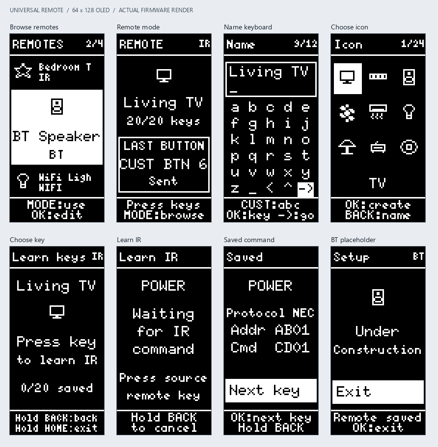

# Universal Remote UI

## Modes and home

The startup shows UNIVERSAL REMOTE for two seconds, then opens **Browse mode**
(the name used for Control mode). The home list has saved remotes followed by
Add remote. An empty device shows only Add remote. UP/DOWN moves the focus.

On a saved remote, MODE selects it and enters **Remote mode**. Its name,
connection, assigned-key count, last button and transmission status are shown.
Every key except MODE controls the appliance; unassigned keys show Unassigned.
MODE returns to the same home selection.

OK on a saved remote opens its editor: Learn keys (or Setup for BT/WiFi),
Name, Icon and Remove. MODE has no effect in the editor or setup screens.
Removal opens a confirmation with Cancel selected.

## Add a remote

1. **Connect**: IR, BT or WIFI.
2. **Name**: up to 12 characters. Arrows navigate a five-column keyboard and OK
   enters the selected character. Any custom button cycles abc, ABC and 123.
   The on-screen underscore inserts a space, < deletes, ^ switches keyboard,
   and -> advances when selected with OK. Names cannot be empty or all spaces.
3. **Icon**: choose from 24 predefined appliance and general icons using arrows
   and OK. More icons appear as focus moves between pages.

The remote is written to storage only when its icon is accepted. BACK moves
to the preceding step; HOME discards the uncommitted draft and returns home.
Failed saves keep the current step open and report Save failed.

BT/WiFi remotes are saved at the same point, then show Under Construction with
Exit selected. OK, BACK or HOME exits to the home list. Their Remote mode
reports Not ready; no BT/WiFi transport is implemented.

## Learn IR keys

After creating an IR remote, or choosing Learn keys in its editor:

1. Press any physical key except MODE to select the key to assign.
2. If it already has a command, inspect its NEC address/command, then choose
   Re-record with OK, or hold BACK to keep the current recording.
3. Aim the source remote at the receiver and press its corresponding button.
   The screen shows Waiting for IR command and the selected key's name.
4. A decoded command is durably saved before showing Saved, Protocol NEC,
   Addr and Cmd. OK returns to key selection. Assigning every key is optional;
   a remote can remain with zero, one or any number of its 20 keys assigned.

The existing NEC capture/replay representation is retained: address and command
are each displayed as four hexadecimal digits. Other IR protocols are not
implemented. Unsupported frames/noise display NEC only; retry while listening
continues within a 15-second window. Timeout/reader errors offer OK to retry.

Short BACK in key selection chooses BACK as the learning target, just like any
other appliance key. Hold BACK (700 ms) to return to the previous screen.
Short BACK on the IR waiting, saved or re-record screen does not cancel;
holding it cancels/returns to key selection. A hold that begins on key selection
returns to the editor or home, even if its initial press opens BACK's recorder.
Short HOME in key selection chooses HOME; holding HOME exits setup. On other
setup screens, short HOME returns home. Outside IR setup, BACK works as before;
in Remote mode it sends the appliance's BACK command.

Leaving the waiting screen cancels reception. Each learning request has an ID;
late results are ignored and cannot be saved against another key or remote.
Re-recording keeps the old binding until a replacement is successfully saved.
If saving fails after capture, Retry save retains the captured command on screen.

## Stored data

Up to 16 remotes are stored in a versioned NVS profile blob with a checksum.
Failed create, edit, delete or key saves restore the in-memory model. An
unreadable/corrupt store is reported without erasing or overwriting it.

Existing ungrouped IR recordings are migrated, in order, to Saved IR 1 and,
when needed, Saved IR 2. Each group uses key 1, then keys 3 through 21, skipping
MODE. Thus legacy IR_1 is POWER on Saved IR 1, IR_2 is CUST BTN 2, and IR_21 is
POWER on Saved IR 2. All 32 old slots can be preserved. The old ir/slots blob
is retained. Migration is performed only when no new profile blob exists.

## Verification

Run tests/host/run.ps1 with a Windows GCC installation and the checked-out u8g2
dependency. The host harness compiles the real UI, rendering and storage code,
with in-memory substitutes for FreeRTOS queues and NVS. It exercises navigation,
all 20 bindings, overwrite/cancel/retry, save failures, restart, migration and
corrupt storage. It also exports actual 64x128 framebuffer snapshots to
build_host/*.pbm.

To regenerate the contact sheets, run tests/host/render_preview.py with Python
and Pillow after the host tests. These are actual screen renders, not mockups.
The firmware must also pass the ESP-IDF build. Electrical keypad behavior, OLED
mounting direction and physical IR reception/transmission require a hardware
check; they are not simulated by the host harness.

The active OLED setup uses SH1106 at 0x3C with the controller's two-column RAM
offset, matching the working OLED example projects. In portrait that offset
corresponds to two rows. The first frame is written before waking the panel.

The approved larger text is shown in [the BMP comparison](typography/before-after.bmp).
Main labels use 6x10 text and hints use 5x8. Long names and dense list neighbors
use smaller text where necessary to fit the 64-pixel width. The footer leaves
space for lowercase descenders. Name entry retains its 12-character limit.
The individual before/after BMPs are native 64x128 monochrome images; the original
proposal BMPs are retained too. Regenerate the applied renders with
tests/host/render_typography_preview.py; the original-font baseline is preserved.
