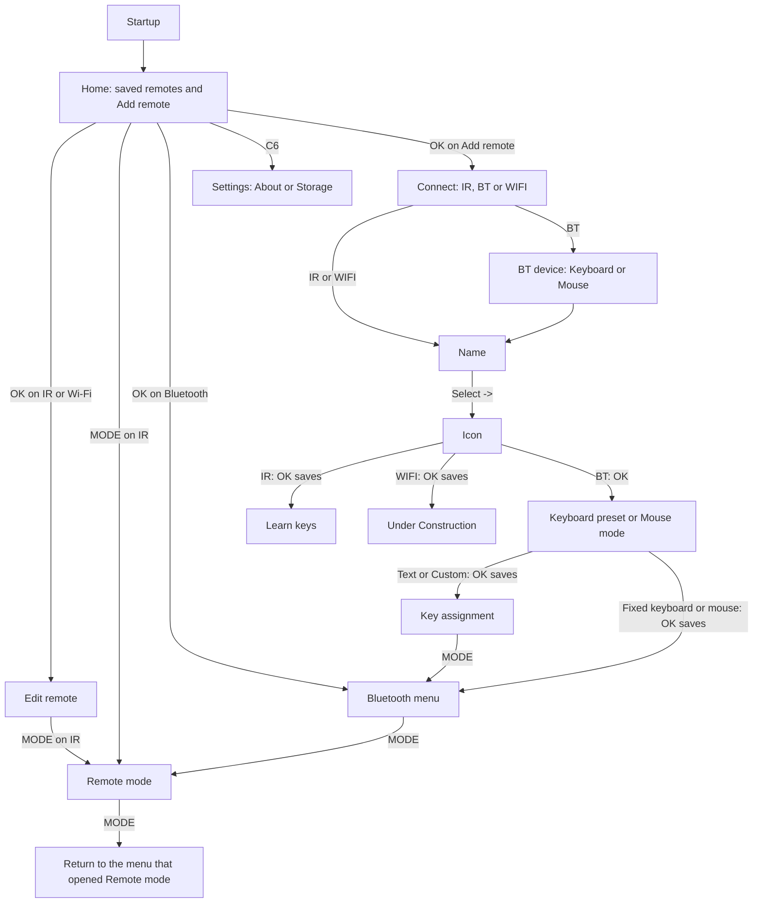
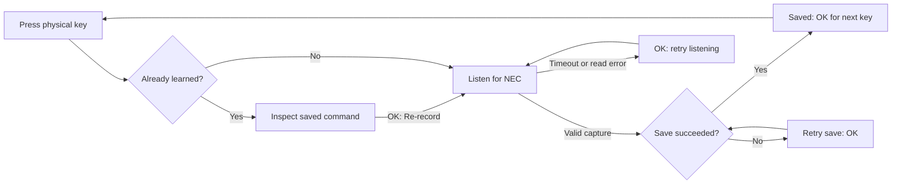
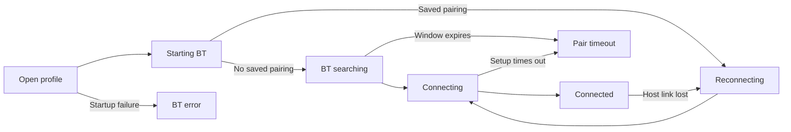

# Universal Remote: user guide

This guide describes the current firmware, including every page, the choices
on that page, and what the physical buttons do. For implementation details,
use the [developer guide](developer-guide.md).

Behavior reference: repository firmware checked on **2026-10-28**.

## Contents

- [What the remote supports](#supported-features)
- [Buttons and navigation rules](#buttons)
- [Quick start and navigation flow](#quick-start)
- [Page-by-page reference](#pages)
- [Keyboard preset mappings](#keyboard-mappings)
- [Mouse controls](#mouse-controls)
- [Saved data and limits](#saved-data)
- [Messages and troubleshooting](#troubleshooting)

## What the remote supports

| Remote type | Available behavior |
| --- | --- |
| IR | Learn and replay NEC infrared commands from an existing remote. |
| Bluetooth keyboard: Fire TV | Fixed arrow, Enter, Back, launcher, function-key and Power mappings. |
| Bluetooth keyboard: Media control | Fixed media, volume, navigation and Power mappings. |
| Bluetooth keyboard: Text | Assign a string of up to 64 characters to each appliance button. |
| Bluetooth keyboard: Custom | Assign standard keyboard keys and Ctrl/Shift/Alt combinations. |
| Bluetooth mouse: Mouse mapped | Pointer movement, clicks, drag/drop, wheels and extra mouse buttons. |
| Bluetooth mouse: Patterns | Continuous directional or organic movement with optional left-button hold. |
| Bluetooth Controller | Listed during creation; selecting it displays **On hold**. |
| Wi-Fi | A saved placeholder with an **Under Construction** page; no appliance control. |

Bluetooth pairs as an accessory named **UR &lt;remote name&gt;**. Each saved
Bluetooth remote has its own accessory identity and saved host. Create separate
profiles for separate hosts or for keyboard and mouse use. Icon selection only
changes appearance; choosing a TV or AC icon does not install commands for it.
The host must support BLE HID keyboards/mice; Bluetooth availability alone does
not guarantee it supports this accessory type.

## Buttons and navigation rules

### Button names

Numbers match the numbered keypad/PCB. **C2** through **C6** below mean the
physical buttons labelled **CUST BTN 2** through **CUST BTN 6**, respectively.
There is no CUST BTN 1 in the current button list.

| Key number | Button | Key number | Button |
| --- | --- | --- | --- |
| 1 | POWER | 12 | HOME |
| 2 | MODE | 13 | VOL UP |
| 3 | C2 | 14 | CH UP |
| 4 | C3 | 15 | VOL CLICK |
| 5 | UP | 16 | CH CLICK |
| 6 | LEFT | 17 | VOL DOWN |
| 7 | OK | 18 | CH DOWN |
| 8 | RIGHT | 19 | C4 |
| 9 | DOWN | 20 | C5 |
| 10 | BACK | 21 | C6 |
| 11 | PLAY/PAUSE | | |

POWER is an appliance command in Remote mode. It does not switch the ESP32
device itself off. VOL CLICK and CH CLICK are separate buttons from VOL/CH
UP and DOWN.

### Tap, hold and repeat

- **Tap** means press and release normally.
- **Hold** means keep the button down for about **700 ms**.
- Arrows, VOL UP/DOWN and CH UP/DOWN repeat while held, after about 350 ms.
  Repeat timing also depends on scanning. Other buttons do not auto-repeat.
- The keypad handles one contact at a time. Use the latched drag procedure
  described below instead of trying to hold OK and a direction simultaneously.

### The rules that depend on the page

| Where you are | BACK | HOME | MODE |
| --- | --- | --- | --- |
| Normal menus/editors | Return/cancel as described for that page. | Return to the home list; unsaved edits are discarded. | Only enters control from the remote editor or Bluetooth menu. |
| IR **Learn keys** picker | Tap selects BACK to learn; hold leaves the picker. | Tap selects HOME to learn; hold returns home. | No action. |
| IR saved-key, waiting or result details | Tap does not leave; hold goes back. | Return home and end learning. | No action. |
| Text/Custom **Key map** assignment picker | Tap selects BACK to assign; hold leaves assignment. | Tap selects HOME to assign; hold returns home. | Finish assignment and return to the previous menu. |
| Remote mode | Send the configured appliance/mouse action, if assigned. | Send the configured appliance/mouse action, if assigned. | Leave Remote mode and return to its previous menu. |

**In Remote mode, HOME and BACK do not navigate the OLED. Press MODE first.**
Holding HOME/BACK in Remote mode does not provide a local exit shortcut.
On other setup pages, holding HOME also returns home. The startup page ignores
button actions until it finishes.

Holding BACK from an assignment picker may briefly open BACK's assignment
screen on the initial press. Keep holding: the remote returns to the menu
outside that picker, rather than leaving you in the briefly opened screen.

All buttons not listed for a page have no additional action, apart from these
shared navigation rules. In particular, MODE does not advance a creation wizard,
close a confirmation, or exit a fixed key-map viewer.

## Quick start and navigation flow

### Learn and use an IR remote

1. On home, select **Add remote**, then **IR**.
2. Enter a name, select the on-screen **->**, then select an icon and press OK.
   The remote is now saved, even before any commands are learned.
3. On **Learn keys**, press the physical button you want to program.
4. Point the source remote at the IR receiver and press its corresponding button.
5. Wait for **Saved**, then press OK to program another button.
6. Hold HOME to finish. Select the saved remote on home and press MODE.
7. Aim the IR transmitter at the appliance and press a learned button. MODE exits.

### Pair and use a Bluetooth keyboard or mouse

1. Choose **Add remote > BT > Keyboard** or **Mouse**.
2. Enter a name, choose an icon, then select the keyboard preset or mouse mode.
   That last selection saves the remote and starts Bluetooth.
3. For Text/Custom, assign buttons first or press MODE to reach the Bluetooth menu.
4. When **BT searching** appears, open the host's Bluetooth accessory pairing
   screen and choose **UR &lt;name&gt;**. There is no device-selection list on the OLED.
5. Wait for **Connected**. Press MODE to control the host.
6. MODE returns to the Bluetooth menu while retaining the connection. BACK from
   that menu returns home and turns Bluetooth off; the pairing remains saved.

When reopening a saved Bluetooth profile, press OK on its home tile. It attempts
to reconnect to its saved host. MODE directly on a Bluetooth home tile displays
**OK:open first**.

### Main page flow

For a new remote, BACK steps through earlier wizard pages. HOME abandons an
unfinished wizard. Once the final save has succeeded, HOME does not delete the
new profile. Name/icon editing of an existing profile saves only when confirmed.

## Page-by-page reference

The page numbers below are reference labels for this guide, not numbers shown
on the OLED. Normal menus use UP/DOWN and OK; selection usually stops at the
first/last item. Confirmations toggle between their two choices.

### P00 — Startup

**Shows:** UNIVERSAL REMOTE for about two seconds. There are no selectable
options. Buttons do not skip it. It opens the home list automatically.

### P01 — Home / REMOTES

**Shows:** saved remote tiles followed by **Add remote**, with the selected
tile's name, icon and transport. An empty device has only Add remote.

| Button | Action |
| --- | --- |
| UP / DOWN | Select the previous/next tile. |
| OK on IR/Wi-Fi | Open its editor. |
| OK on Bluetooth keyboard/mouse | Open its Bluetooth menu and start reconnecting/pairing. |
| OK on Add remote | Begin creation. |
| MODE on IR | Enter Remote mode directly; MODE there returns home. |
| MODE on Bluetooth/Wi-Fi | Show **OK:open first**; no control session starts. |
| C6 | Open device Settings. |
| BACK, HOME, LEFT/RIGHT | No further page navigation. |

At 16 profiles, Add remote displays/reports **Storage full**. **Storage error**
means the saved data could not be loaded; creating a profile is blocked.

### P02 — REMOTE / appliance control

**Enter:** MODE from the selected remote's editor/Bluetooth menu, or directly
from an IR home tile. **Shows:** name/icon, connection or assignment count,
and last-button or movement information.

| Button | Action |
| --- | --- |
| MODE | Stop local control and return to the menu that opened it. Bluetooth normally stays connected. |
| Any of the other 20 buttons | Send the learned IR command, keyboard assignment/text, or mouse action. |
| HOME / BACK | Appliance actions, if assigned; they do not leave this page. |
| POWER hold | Fire TV preset: Ctrl+Alt+Delete once. Other keyboard presets do not add this hold shortcut. |

An unassigned key displays **Unassigned**. Keyboard/IR sends may show
**Sending...**, **Sent**, **Send failed**, **BT offline**, or **Busy: retry**.
**Sent** means the firmware completed its send path; check the appliance to
confirm the intended action. Mouse feedback shows movement and saved speed;
**HOLD** means the left mouse button is latched down. MODE releases held mouse
buttons and stops patterns. See the mapping tables below for each mode.

### P03 — Edit remote

**Enter:** OK on an IR/Wi-Fi home tile, or **Edit remote** from Bluetooth.

| Option | What OK opens |
| --- | --- |
| Learn keys / Key map / Setup | IR learning, Bluetooth assignments, or Wi-Fi placeholder, respectively. |
| Name | Rename this profile. |
| Icon | Change this profile's icon. |
| Remove | Confirmation before deletion. |

UP/DOWN selects; OK opens; BACK returns to the previous menu. MODE enters
Remote mode for IR or an already open Bluetooth session. HOME exits to home;
for Bluetooth this also closes its session. Keyboard preset/mouse mode cannot
be changed here; create another profile to select a different one.

### P04 — Connect / creation

**Options:** IR, BT, WIFI. UP/DOWN selects; OK advances. IR/WIFI go to Name;
BT goes to BT device. BACK returns home. HOME abandons creation. Nothing is
saved and Bluetooth is still off at this step.

### P05 — Name

**Enter:** creating or renaming a remote. **Shows:** current text and a
12-character limit, above a five-column on-screen keyboard.

| Button or selected cell | Action |
| --- | --- |
| Arrows | Move between keyboard cells without wrapping past their edges. |
| OK | Activate the selected cell. |
| C2 / C3 / C4 / C5 / C6 | Cycle lowercase, uppercase and numbers/punctuation pages. |
| `_` cell | Insert a space. |
| `<` cell | Delete the last character. |
| `^` cell | Cycle keyboard pages. |
| `->` cell | Creation: accept name and open Icon. Renaming: save and return. |
| BACK | Previous page/cancel the rename. |
| HOME | Return home and discard unsaved text. |

Select the cells with arrows and then press OK: these symbols are not separate
physical buttons. Leading/trailing spaces are removed from names. An empty or
all-space name displays **Enter a name**. **12 char max** prevents additional
characters. A failed rename stays open with **Save failed**.

The four special cells occupy the last row's final four positions. The same
symbols appearing among the ordinary character cells on a number/symbol page
are literal characters, rather than edit commands.

### P06 — Icon

**Options:** 24 icons: TV, Soundbar, Speaker, Fan, AC, Light, Lamp, Set-top,
Disc, Gamepad, Projector, Monitor, Laptop, Phone, Camera, Plug, Curtain,
Heater, Receiver, Streamer, Bluetooth, WiFi, Home and Star.

LEFT/RIGHT moves one icon; UP/DOWN moves one row of three. The grid changes
page as necessary. The icon name and position are shown below/above the grid.

| Context | OK | BACK |
| --- | --- | --- |
| New IR | Save profile and open Learn keys. | Return to Name. |
| New Wi-Fi | Save profile and open Under Construction. | Return to Name. |
| New Bluetooth | Open BT preset / Mouse mode; profile is not saved yet. | Return to Name. |
| Editing an icon | Save the icon and return to the editor. | Cancel and return to the editor. |

HOME discards an unconfirmed selection and returns home. On **Save failed**,
the page remains open so you can retry.

### P07 — Learn keys / IR key picker

**Enter:** immediately after creating IR, or **Edit remote > Learn keys**.
**Shows:** remote name/icon and how many of the 20 assignable buttons are saved.

| Button | Action |
| --- | --- |
| Any appliance key, including arrows, OK, POWER and custom buttons | Select that physical key to learn. Unassigned keys open listening; assigned keys show the saved command first. |
| BACK tap | Select BACK as the learning target. |
| BACK hold | Leave this picker and return to its previous menu. |
| HOME tap | Select HOME as the learning target. |
| HOME hold | End setup and return home. |
| MODE | No action; MODE cannot be assigned. |

This is a button picker, not a scrolling list: pressing UP selects UP's IR
binding. A held/repeated key does not select successive learning targets.

### P08 — Key saved / Re-record

**Shows:** the selected physical key, Protocol NEC, and its stored address and
command, with **Re-record** selected.

OK begins listening for a replacement. Hold BACK to return without changing the
existing command. Short BACK does not leave. HOME returns home. MODE and other
keys do not start learning here. The original binding is retained until a new
capture is successfully saved.

### P09 — Learn IR / waiting, timeout or read error

**Shows:** the target key and **Waiting for IR command**. Aim the source remote
at the receiver and press its corresponding button within about 15 seconds.

| State/button | Action or result |
| --- | --- |
| Valid NEC capture | Save it, then open the result page. |
| NEC only | Unsupported/noisy input was received; continue trying during the same listening window. |
| Timed out / Read error | No new command was saved; OK retries listening. |
| OK while still listening | Does not restart or confirm a capture. |
| BACK hold | Cancel listening and return to the key picker. |
| BACK tap | Does not cancel. |
| HOME | End learning and return home. |

MODE and other keys have no action here. If replacing a command, cancellation,
timeout or read failure leaves the original command intact.

### P10 — IR result / Saved or Save failed

**Shows:** key name, NEC address/command, and **Next key** or **Retry save**.

| State | OK |
| --- | --- |
| Saved | Return to Learn keys to select another physical key. |
| Save failed | Retry storing the captured command; it does not ask you to capture again. On success the page becomes Saved. |

Hold BACK to return; short BACK does not leave. HOME returns home. An unsaved
capture is not retained after leaving this page or restarting the device.

### IR learning flow

### P11 — Remove?

**Options:** Cancel (selected initially), Remove. UP or DOWN switches the
selection. OK on Cancel or BACK returns to the editor; OK on Remove deletes the
profile and its assignments. HOME leaves without confirming.

For Bluetooth, removal first clears its saved pairing, then deletes the profile
after the update is saved. **Unpairing...** may appear while that finishes. You
may also need to remove the old accessory entry on the host. **Delete failed**
keeps the profile; **BT busy** means the unpair request was not accepted. Other
profiles are not intentionally removed by this operation.

### P12 — Setup / Under Construction

**Enter:** creating Wi-Fi, or choosing Setup from a saved Wi-Fi editor.
**Option:** Exit. OK, BACK or HOME returns to the home list. The profile is
already saved, but there are no Wi-Fi connection settings or commands. MODE
has no action on this page. Return through its home tile to rename or remove it.

### P13 — BT device

**Options:** Keyboard, Mouse, Controller. UP/DOWN selects; OK on Keyboard or
Mouse advances to Name. Controller displays **On hold** and stays on this page.
BACK returns to Connect; HOME abandons creation. Bluetooth does not start here.

### P14 — Bluetooth connection menu / Keyboard or Mouse

**Enter:** OK on a saved Bluetooth tile, or after saving its creation settings.
**Shows:** profile name, connection status, and three scrolling option rows.

| Option | Action when selected with OK |
| --- | --- |
| Reconnect | Retry the saved host; an unpaired profile starts fresh pairing. If already connected/suspended, show **Already paired**. |
| Pair new | Open confirmation to forget the old connection and start fresh pairing. |
| Unpair | Open confirmation to forget the old connection and stop the session. |
| Key map | Inspect fixed mappings or assign Text/Custom keys. |
| Speed N/10 (mouse only) | Open the saved-speed editor. |
| Edit remote | Open Name, Icon, Remove and the profile's key-map option. |

UP/DOWN selects and scrolls. MODE enters Remote mode. BACK returns home and
turns Bluetooth off. HOME also returns home and closes the session. Navigating
to child settings or switching between this menu and Remote mode normally
keeps the connection alive. A renamed Bluetooth accessory advertises its new
name when reopened; the host may retain its previously cached display name.

### Bluetooth status flow

**Connecting** means setup is still pending. Wait for **Connected** before
expecting normal key delivery. **BT suspended** means the host suspended HID;
an explicit button press may wake it if the host supports that. **Stopping BT**
is shutdown progress. **Unpaired** means the local saved host was cleared.
Reconnect retries after timeout/error. An error may show its failed step and
numeric code; record those if reporting a problem.

### P15 — Pair new? / Unpair?

**Options:** Cancel (initial selection), Confirm. UP/DOWN toggles; OK activates;
BACK cancels; HOME exits to home without confirming the selected action.

- **Pair new + Confirm:** forget this profile's previous bond, save the update,
  and start a fresh pairing window of about two minutes.
- **Unpair + Confirm:** forget the saved bond, save the update, and stop at
  Unpaired. The remote profile and its mappings remain available.

The screen returns to the Bluetooth menu and may show **Updating BT**. These
actions keep the profile's accessory identity. On the host, also forget/remove
the old accessory before re-pairing it; the remote cannot remove the host's copy.
Other profiles keep their own saved connections. This is different from Remove,
which also deletes the profile.

### P16 — Key map

This page has two forms; its controls depend on the preset.

| Profile | Options and buttons |
| --- | --- |
| Fire TV, Media control, either mouse mode | UP/DOWN selects a physical key (skipping MODE) and shows its fixed action. BACK returns. HOME exits home. OK and MODE do not edit/exit this viewer. |
| Text or Custom keyboard | Press the physical key to assign, including arrows, OK, BACK, HOME and custom buttons. Text opens its text editor; Custom opens its key picker. MODE finishes assignment; hold BACK leaves the assignment picker; hold HOME exits home. |

Text/Custom show the assigned count out of 20. Short BACK/HOME are assignable
targets on this picker, not navigation shortcuts. Fixed maps cannot be edited.
The destination on leaving a picker is its actual parent: usually the Bluetooth
menu, or the editor if you entered through Edit remote.

### P17 — BT preset / Mouse mode

**Enter:** creation only, after the icon.

| Device | Available options |
| --- | --- |
| Keyboard | Fire TV, Media control, Text, Custom. |
| Mouse | Mouse mapped, Patterns. |

UP/DOWN selects; OK saves the new profile and starts Bluetooth. Fire TV,
Media control and mouse modes open their connection menu. Text and Custom open
the empty assignment picker above that menu. BACK returns to Icon; HOME
abandons the unfinished profile. On a save failure, the page remains open.

### P18 — Custom key picker

**Enter:** press a target physical key on the Custom assignment picker.
**Shows:** target button, selected keyboard key, active modifiers, and a
two-column key list.

| Button | Action |
| --- | --- |
| LEFT / RIGHT | Move between columns when a neighboring item exists. |
| UP / DOWN | Move one row through the key list. |
| C4 / C5 / C6 | Toggle Ctrl / Shift / Alt for this binding. |
| OK | Save selected key/modifiers and return to the assignment picker. |
| BACK | Cancel this unsaved binding edit. |
| HOME | Exit to home and close Bluetooth. |
| MODE | No action on this editor. |

**Clear** removes the target's assignment. The list includes A–Z, digits,
punctuation, Enter/Esc/Backspace/Tab/Space, lock keys, F1–F24, navigation keys,
numeric-keypad keys, Menu/Power and left/right modifier keys. Media-specific
Consumer commands such as volume are provided by Media control, not as options
in this custom picker. Press C4+C5 as separate taps to choose Ctrl+Shift;
the keypad does not require simultaneous button presses. **Key saved** or
**Key cleared** confirms success; **Save failed** leaves the editor open.

### P19 — Text editor

**Enter:** press a target physical key on the Text assignment picker.
**Shows:** its string, a 64-character limit, and the on-screen keyboard. The
end of a long string stays visible; entry adds/deletes at the end.

| Button or selected cell | Action |
| --- | --- |
| Arrows / OK | Select and activate a cell. |
| C2–C6 or `^` | Cycle abc, ABC, numbers/punctuation and symbols pages. |
| `_` / `<` | Insert a space / delete the last character. |
| `->` | Save and return to the assignment picker. Empty text clears the key. |
| BACK | Cancel this unsaved text edit. |
| HOME | Exit home and close Bluetooth. |
| MODE | No action here; use MODE after returning to the assignment picker. |

Spaces are preserved, including at the start/end. **Text saved**, **Key cleared**,
**64 char max** and **Save failed** describe the result. Text is typed using a
US keyboard layout; configure the host accordingly for matching punctuation.
In Remote mode one press types one complete string. Holding an arrow does not
retype the entire string repeatedly. MODE cancels any remaining typing.

### P20 — Mouse Speed

**Enter:** Speed from a Bluetooth mouse menu. **Range:** 1–10; default 5.

| Button | Action |
| --- | --- |
| UP, RIGHT or VOL UP | Increase the draft speed. |
| DOWN, LEFT or VOL DOWN | Decrease the draft speed. |
| OK | Save and return to the Bluetooth menu. |
| BACK | Cancel this speed edit. |
| HOME | Exit home and close Bluetooth. |
| MODE | No action on this page. |

The saved value applies immediately and remains after reopening/rebooting.
On a save failure the old value is retained and the page stays open. Remote-mode
speed shortcuts save directly instead of opening this draft editor.

### P21 — Device Settings

**Enter:** C6 on the home list. **Options:** About, Storage. UP/DOWN selects;
OK opens; BACK returns to home; HOME also returns home and keeps the highlighted
remote. Other buttons do not change settings. C6 is not a settings shortcut
inside Remote mode or other pages.

### P22 — About

**Shows:** product name/logo and the firmware version. There are no editable
options. Long version strings wrap. BACK returns to Settings; HOME returns
home. OK, MODE and arrows do not change the version or page.

### P23 — Storage

**Shows:** **Reading...**, then bytes used by saved remotes and related pairing
data, and the shared storage space still available. Opening it does not delete
anything. This is saved-data storage, not free space for firmware updates.

OK refreshes; BACK returns to Settings; HOME returns home. **Storage unavailable**
allows another attempt with OK. No formatting, erase or factory-reset option is
provided on this page. The 16-profile limit still applies even with free bytes.

## Keyboard preset mappings

These actions apply only in **Remote mode**. A host/application may interpret
the same keyboard command differently. A dash means Unassigned.

| Physical button | Fire TV | Media control |
| --- | --- | --- |
| POWER | Tap: keyboard PC Power on release; hold: Ctrl+Alt+Delete once | Consumer Power |
| MODE | Return to local menu | Return to local menu |
| C2 | — | Rewind |
| C3 | — | Fast-forward |
| UP / LEFT / RIGHT / DOWN | Corresponding keyboard arrow | Corresponding keyboard arrow |
| OK | Enter | Enter |
| BACK | Esc | Esc |
| PLAY/PAUSE | F8 | Media Play/Pause |
| HOME | Launcher/house Home | Launcher/house Home |
| VOL UP | — | Volume up |
| CH UP | F7 | Next track |
| VOL CLICK | — | Mute |
| CH CLICK | — | Stop |
| VOL DOWN | — | Volume down |
| CH DOWN | F9 | Previous track |
| C4 | Application/Menu | — |
| C5 / C6 | — | — |

For Fire TV, holding POWER sends no additional short-Power command. These are
keyboard mappings, not automatically learned TV IR commands. Text and Custom
start unassigned; every key except MODE can be configured independently.

## Mouse controls

| Physical button | Mouse mapped | Patterns |
| --- | --- | --- |
| UP / LEFT / RIGHT / DOWN | Move while held; release to stop | Tap toggles continuous direction; hold runs until release |
| OK | Tap: left click; hold: latch drag; next tap: drop | Toggle left button held/released |
| PLAY/PAUSE | Right click | Unassigned |
| VOL CLICK | Middle click | Unassigned |
| VOL UP / VOL DOWN | Scroll vertically up/down | Save speed increase/decrease |
| CH UP / CH DOWN | Scroll horizontally right/left | Unassigned |
| C2 / C3 | Mouse Back / Forward buttons | Unassigned |
| C4 | Save speed increase | Tap toggles organic movement; hold runs until release |
| C5 | Save speed decrease | Unassigned |
| POWER / BACK / HOME / CH CLICK / C6 | Unassigned | Unassigned |
| MODE | Stop/release and return to Bluetooth menu | Stop/release and return to Bluetooth menu |

### Click and drag

In Mouse mapped, a short OK click occurs on release. Two short taps act as two
clicks; the host decides whether that is a double-click. For dragging:

1. Position the pointer, then hold OK for about 700 ms until **HOLD** appears.
2. Release OK. The left mouse button stays down.
3. Use the directional buttons to move the object.
4. Tap OK to release/drop. MODE also releases it when leaving control.

Right/middle clicks and wheels preserve an existing left-button hold. Horizontal
scroll and extra mouse buttons require support from the host/application.

### Pattern movement

Tap a direction or C4 to start; tap the same key to stop. Another pattern key
replaces the current movement. Hold a pattern key for at least 700 ms to make
it momentary: releasing it stops movement. If that pattern was already running,
the initial press stops it, the hold starts it again, and release stops it.
Auto-repeat does not repeatedly toggle patterns.

C4's organic pattern curves, changes direction/speed and occasionally pauses;
it does not click automatically. OK toggles left-button hold independently,
so you can combine movement with drawing/dragging. MODE stops both movement
and button hold. Link loss, suspension or reopening starts movement idle; start
the pattern/hold again explicitly when ready.

## Saved data and limits

| Item | Limit / save behavior |
| --- | --- |
| Remote profiles | 16 total across all transports. |
| Name | 12 characters; leading/trailing spaces trimmed. |
| Icon choices | 24, cosmetic only. |
| Assignable buttons | 20 per remote; MODE is reserved. |
| Text | 64 characters per assigned key; spaces retained. |
| Mouse speed | 1–10, default 5, saved separately per profile. |
| IR protocol | NEC capture/replay only. |
| New IR/Wi-Fi profile | Saved when Icon is confirmed. |
| New Bluetooth profile | Saved when the preset/mouse mode is confirmed. |
| Individual edits | Save on confirmation; cancel/home discards the current unsaved edit. |

Working recordings and pairings survive a normal restart. Older supported saved
formats are loaded/migrated without asking you to relearn all buttons. A failed
save keeps the preceding stored data; do not assume an edit succeeded until its
success message appears. Leaving Bluetooth turns its radio session off while
retaining the saved pairing. Unpair clears the connection, not its key map;
Remove deletes the complete selected profile.

## Messages and troubleshooting

| Message or symptom | Meaning and next action |
| --- | --- |
| OK:open first | Open the home tile with OK before MODE. Bluetooth starts from its menu. |
| Unassigned | Learn/configure this button, or use a key mapped by the selected fixed preset. |
| Busy: retry / BT busy | The request was not accepted. Wait for current work and try again. |
| NEC only | The captured signal was unsupported/noisy. Retry with a NEC source remote within the listening window. |
| Timed out / Read error | No new IR command was saved. OK retries; check aiming/source remote. |
| Save failed | The edit was not committed. Keep the page open and retry; leave only if you intend to discard it. |
| Storage full | At most 16 profiles can be created. Remove an unwanted profile first. |
| Storage error / unavailable | Data could not be loaded/accounted for. Storage-page OK retries accounting; there is no automatic erase/reset command. |
| BT searching | Pair from the intended host's accessory settings. Other nearby hosts may connect during fresh pairing. |
| Reconnecting | This profile accepts its saved host. Turn that host's Bluetooth on; use Pair new if intentionally changing hosts. |
| Connecting | A link exists but input setup is incomplete. Wait; if it does not finish, record status and retry Reconnect. |
| Pair timeout | Retry Reconnect/Pair new and complete pairing within the next window. |
| Forget on host | Remove the old accessory pairing on the host as well, then retry pairing. |
| BT error / BT offline / Send failed | Wait for readiness or retry Reconnect. Record the displayed step/code if repeated. |
| Arrow keys navigate the OLED instead of the host | You are in a menu. Press MODE from the Bluetooth menu/editor to enter Remote mode. |
| HOME/BACK does not leave appliance control | Press MODE; HOME/BACK are appliance buttons there. |
| Pointer keeps moving / left button stays down | Stop its pattern or tap OK to release drag; MODE stops/releases both. |
| Wrong punctuation in Text | Select a US keyboard layout on the host. |

For more pairing details see [Bluetooth setup](bluetooth.md); for mouse examples
see [mouse controls](bluetooth-mouse.md). Wiring, not needed for normal use, is
documented in [the keypad reference](keypad.md).
